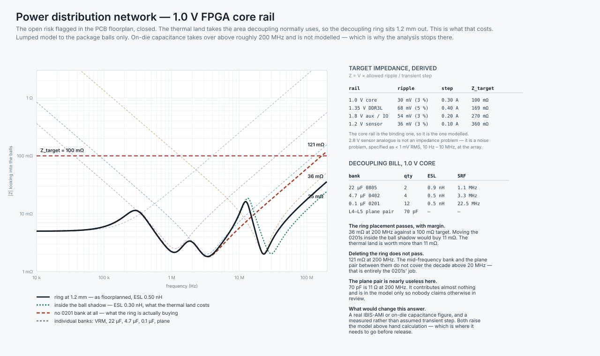

# Hardware interfaces, PDN and BOM

**Part 5 of the TIDA-010083 review.** Part 4 committed the architecture to copper. This part pins down the things a second engineer needs in order to draw the schematic without asking you a single question: every connector pin, every net class, every rail, and the power-distribution analysis that Part 4 left open.

The machine-readable files in this folder are the deliverable. The prose explains why they say what they say.

| File | Use |
|---|---|
| [`pinout-J1-tida-df40.csv`](pinout-J1-tida-df40.csv) | 50-way board-to-board, carrier ↔ TIDA-010083 |
| [`pinout-J2-sensor-fpc.csv`](pinout-J2-sensor-fpc.csv) | 30-way flex, carrier ↔ sensor board |
| [`net-classes.csv`](net-classes.csv) | Impedance, geometry and matching rules, for import into a constraint manager |
| [`power-budget.csv`](power-budget.csv) | Rail by rail, with the 5 V draw each one costs |
| [`carrier-bom.csv`](carrier-bom.csv) | Key items; passives summarised by function |

---

## 1. Interface control — J1, carrier ↔ TIDA-010083

**Hirose DF40C-50DS-0.4V, 0.4 mm pitch, 4 mm stack height.** 22 signals, 6 × 5 V contacts, 20 grounds, 2 reserved.

### Why 50-way and not 40

The signal count is 22, so 40 pins looks sufficient. It is not, for two reasons that only appear when you do the arithmetic:

**Current.** The TIDA board delivers up to 2.3 A. A DF40 contact is rated around 0.5 A, so 2.3 A needs five contacts minimum and six for any derating at all. Six 5 V contacts plus twenty grounds plus twenty-two signals is 48, and the next size up is 50.

**Return path.** Twelve of the twenty-two signals are RGMII at 125 MHz DDR. Across a connector, the return current has to find a ground pin, and the loop it takes is the loop that radiates. Twenty grounds for twenty-two signals gives every clock a ground on both sides and no signal more than one pin from a return. That ratio is the single cheapest EMI decision available on this board, and the two spare pins cost nothing.

### Pin assignment rules used

1. **Both RGMII clocks are flanked by ground** (pins 7·8·9 and 32·33·34).
2. **TX and RX groups are on different rows**, so the two source-synchronous directions never run adjacent through the connector.
3. **MDIO sits next to MDC**, both slow, both away from the clocks.
4. **PHY_INT_N is an input on the carrier and is never driven.** Part 1 §7 explains why: the pin's power-on function is POWER DOWN, and an FPGA that drives it low during configuration produces a PHY that answers MDIO and never links. The constraint file must declare it input-only.
5. **RX_CTL is also a four-level strap pin.** Its divider lives on the carrier, referenced to +VIO, per the TIDA schematic note "further strapping done on other board."

---

## 2. Interface control — J2, carrier ↔ sensor board

**30-way, 0.5 mm pitch ZIF, top contact.** Sixteen positions for five MIPI pairs with a ground between each, six control signals, four power and four returns.

### The ground pattern is the whole design

```
G  CLK±  G  D0±  G  D1±  G  D2±  G  D3±  G
```

Five pairs, six grounds, sixteen positions. Anything less and adjacent pairs share a return through the connector, which is where flex-to-board crosstalk actually happens — not along the flex, where the pairs are separated by a ground conductor and a ground plane, but in the 3 mm of the connector where the plane stops.

### EXTCLK is the other thing to get right

`CAM_EXTCLK` is a 24 MHz clock the carrier drives into the sensor. It is the only continuously toggling single-ended signal on the flex, so it gets ground on both sides (pins 16 and 18) and it is placed as far from the MIPI block as the connector allows.

### The power pins say something about the architecture

`+3V3_CAM` feeds the **TPS7A20 LDO on the sensor board**, not the sensor. That is the change Part 4 §1 made to Part 2's part selection, and this pinout is where it becomes visible: there is no 2.8 V conductor on this flex, because 2.8 V is made 20 mm from the pixel array rather than 60 mm away. An LDO's power-supply rejection is a property of the loop at the load, and a flex between the regulator and the load discards most of it.

---

## 3. Power distribution network



Part 4 §2.4 flagged this as the board's largest open risk: the thermal land takes the bottom-side area under the FPGA that decoupling normally uses, so the 0201 ring sits about 1.2 mm outside the ball shadow. **The analysis now closes that risk, and the answer is that the floorplan is fine.**

### Target impedance

```
Z_target = V × allowed ripple / transient step
```

| Rail | Ripple allowed | Transient step | Z_target |
|---|---|---|---|
| 1.0 V core | 30 mV (3 %) | 0.30 A | **100 mΩ** |
| 1.35 V DDR3L | 68 mV (5 %) | 0.40 A | 169 mΩ |
| 1.8 V aux / IO | 54 mV (3 %) | 0.20 A | 270 mΩ |
| 1.2 V sensor digital | 36 mV (3 %) | 0.10 A | 360 mΩ |

The core rail is the binding one, so it is the one modelled. The 2.8 V sensor analogue rail is deliberately absent from this table: it is not an impedance problem but a noise problem, specified as **< 1 mV RMS over 10 Hz – 10 MHz measured at the array**, and met by the LDO rather than by decoupling.

### The model

Lumped, to the package balls only. On-die capacitance takes over above roughly 200 MHz and is not modelled — which is exactly why the analysis stops there and why the conclusion needs an IBIS-level model before release.

| Bank | Qty | ESL assumed | Self-resonance |
|---|---|---|---|
| VRM (TPS62802, 4 MHz) | 1 | 4 nH effective | — |
| 22 µF 0805 | 2 | 0.9 nH | 1.1 MHz |
| 4.7 µF 0402 | 4 | 0.5 nH | 3.3 MHz |
| 0.1 µF 0201 | 12 | 0.5 nH mounted | 22.5 MHz |
| L4–L5 plane pair | 70 pF | — | — |

### The result

| Case | Peak in band | At 200 MHz | Verdict |
|---|---|---|---|
| **Ring at 1.2 mm — as floorplanned** | 36 mΩ | 36 mΩ | **passes, 2.8× margin** |
| Inside the ball shadow, ESL 0.30 nH | 25 mΩ | 25 mΩ | passes |
| No 0201 bank at all | 121 mΩ | 121 mΩ | **fails** |

Three conclusions worth stating in that order:

1. **The thermal land is affordable.** Moving the 0201s from 1.2 mm out to inside the ball shadow buys 11 mΩ against a 100 mΩ target. Part 4 §7 shows the land buys 30 °C of junction temperature. That is not a close trade.
2. **The ring itself is not optional.** Deleting it costs a factor of 3.4 and blows the target. The decade above 20 MHz is entirely the 0201s' job — the 4.7 µF bank has already gone inductive and the plane pair is nowhere.
3. **The plane pair contributes almost nothing.** 70 pF is 11 Ω at 200 MHz. It is in the model so that nobody claims otherwise in review. Part 4 §3.3 says the same thing; this is the number behind it.

### What would change this answer

A measured rather than assumed transient step, and a real on-die capacitance figure. Both move the analysis above hand calculation, which is where it has to go before the board is released. The mounted-inductance assumption of 0.5 nH is the other soft spot: it comes from a short microvia to L2 through an 80 µm dielectric, and if the layout ends up routing the 0201s to L2 through a longer path it degrades quickly.

---

## 4. Power budget

Full table in [`power-budget.csv`](power-budget.csv). The summary:

| | Value |
|---|---|
| Available from TIDA-010083 | ≈ 11.0 W at 5 V (Part 2 §15) |
| Carrier total, estimated | ≈ 2.7 W drawn from 5 V |
| **Headroom** | **≈ 8.3 W** |

That headroom is not spare capacity, and Part 2 §15 is right to say so. In a real inspection camera the integrated illumination is usually the largest single consumer, and §8.5 below explains why the exposure time — and therefore the strobe energy — is set by the optics rather than by the electronics. Budget it deliberately.

Two figures in the table are estimates with no measurement behind them: the FPGA core at 0.60 A and the FPGA auxiliary at 0.25 A. Run the Lattice Power Calculator against the synthesised design before anyone orders a regulator.

---

## 5. Bill of materials

[`carrier-bom.csv`](carrier-bom.csv). Key items only; passives are summarised by function rather than enumerated, because the enumeration follows from the schematic and the schematic does not exist yet.

Four entries deserve a note:

**Y1, the 25 MHz oscillator.** Part 2 deleted it in favour of the PHY's CLK_OUT ÷5. Part 4 §2.3 puts it back for the DDR3L PLL and keeps CLK_OUT for the IEEE 1588 counter. ±25 ppm rather than ±50 ppm costs almost nothing and gives the DDR3L controller margin it will not otherwise have.

**C_CHASSIS, the 1 nF chassis bonds.** 2 kV X7R in 0603. They see the full ESD transient. A 50 V 0402 in that position fails short, and a shorted high-frequency bond is a DC bond nobody designed — see Part 4 §8.2.

**R_STRAP, the four-level dividers.** 1 % thin film, and never tied directly to a rail. Strap pins become functional outputs the moment reset releases, and a strap pulled hard to VDD is a short. Part 1 §8 has the divider table.

**U2 and U3, DDR3L and flash.** Deliberately left as TBD rather than guessed. The DDR3L package outline drives the east flank of the floorplan, so confirm it before committing the placement; and the flash must be a 1.8 V part because the CrossLink-NX configuration bank runs at 1.8 V.

---

## 6. What is still missing here

- **There is no schematic.** This folder describes every interface a schematic needs, and it is not one. Net-level capture, ratings, derating analysis and a costed BOM are the next piece of work.
- **No IBIS models have been run.** The net classes in `net-classes.csv` are targets, not simulated results.
- **The PDN model has no on-die term** and the transient step is assumed.
- **No derating analysis.** Capacitor DC bias, inductor saturation over temperature, connector current derating at 85 °C — all absent, and all of them bite on a board this dense.
