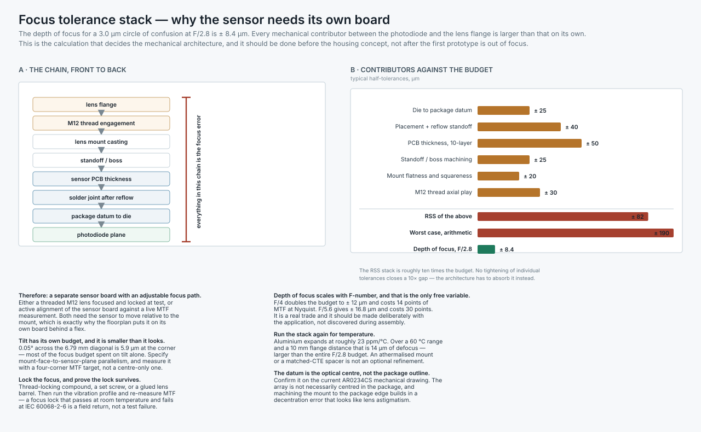

# Mechanical, thermal and environmental

**Part 7 of the TIDA-010083 review.** Part 6 said the lens needs to land within ± 8.4 µm of the photodiode plane. This part does the stack that shows it cannot, and draws the architectural conclusion that follows.

Mechanical design on a camera is not packaging. It is the discipline that owns the focus budget, the only heat path, and the Faraday cage — three things that Parts 4, 6 and 8 all depend on and none of them can fix.



---

## 1. The focus tolerance stack

Depth of focus on the image side, with a circle of confusion equal to one pixel:

```
depth of focus = ± F# × c = ± 2.8 × 3.0 µm = ± 8.4 µm   at F/2.8
```

Every mechanical element between the photodiode and the lens flange contributes to the focus error. Typical half-tolerances:

| Contributor | ± µm |
|---|---|
| Die to package datum | 25 |
| Placement and reflow standoff | 40 |
| PCB thickness, 10-layer | 50 |
| Standoff / boss machining | 25 |
| Mount flatness and squareness | 20 |
| M12 thread axial play | 30 |
| **RSS** | **82** |
| **Worst case, arithmetic** | **190** |
| **Budget available** | **8.4** |

The RSS stack is roughly **ten times** the budget. No tightening of individual tolerances closes a 10× gap — a tolerance you can hold at ± 5 µm on a machined part costs more than the camera. The architecture has to absorb it instead.

### Therefore: an adjustable focus path, and a separate sensor board

Two viable mechanisms:

- **Threaded M12 lens, focused and locked at test.** Cheap, well understood, and the thread itself contributes ± 30 µm of the stack — which does not matter once you are adjusting against a live measurement rather than assembling to a drawing.
- **Active alignment of the sensor board** against a live MTF measurement, then bonded. More capable (it corrects tilt and decentration as well as focus), considerably more expensive in equipment.

Either way the sensor has to move relative to the mount, which is exactly why the floorplan in Part 4 puts it on its own board behind a flex rather than on the carrier.

### Tilt has a separate budget, and it is smaller than it looks

0.05° across the 6.79 mm diagonal is 5.9 µm at the corner — most of the F/2.8 focus budget spent on tilt alone. Specify **mount-face to sensor-plane parallelism**, and measure it with a four-corner MTF target rather than a centre-only one. A camera focused perfectly on axis and tilted 0.1° looks sharp in the middle and soft on one side, and the failure gets misdiagnosed as a bad lens.

### Run the stack again for temperature

Aluminium expands at roughly 23 ppm/°C. Over a 60 °C operating range and a 10 mm flange distance that is **14 µm of defocus** — larger than the entire F/2.8 budget, from thermal expansion alone. An athermalised mount, or a spacer whose CTE is matched against the flange material, is not an optional refinement on a camera specified over an industrial temperature range.

### The datum is the optical centre, not the package outline

Confirm this on the current AR0234CS mechanical drawing. The array is not necessarily centred in the package, and machining the mount to the package edge builds in a decentration error that presents as lens astigmatism and gets blamed on the lens.

### Depth of focus is the one free variable

| Aperture | Depth of focus | MTF at Nyquist |
|---|---|---|
| F/2.0 | ± 6.0 µm | 77 % |
| F/2.8 | ± 8.4 µm | 68 % |
| F/4 | ± 12.0 µm | 54 % |
| F/5.6 | ± 16.8 µm | 38 % |

Going from F/2.8 to F/4 doubles the assembly budget and costs 14 points of MTF. It is a real trade, it should be made deliberately with the application in the room, and it should not be discovered on the assembly line.

---

## 2. The thermal interface

Part 4 §7 establishes that the FPGA needs a conduction path or its junction lands near 102 °C against a 100 °C industrial limit. The path is:

```
junction → package substrate → ball field → 64 filled vias → bottom-side land
        → thermal gap pad → machined boss → housing wall → ambient
```

Three of those elements are mechanical deliverables:

**The gap pad.** Compressible, ≥ 3 W/m·K, thickness chosen from the *nominal* gap with enough compression range to cover the tolerance on that gap — which, given §1, is not small. Specify the compressed thickness and the compression force, not just the part number: an over-compressed pad puts a continuous load on a 289-ball csBGA and an under-compressed one is an air gap.

**The boss.** Machined flat, on the housing wall, directly opposite the FPGA. It has to survive the board being removed and refitted during service without the pad tearing.

**The path the sensor must *not* share.** The sensor board's only conduction routes to the carrier are the flex and the lens-mount casting. The flex is deliberately thin copper. Do not add a ground pour to it "for better grounding" — it is also a thermal bridge, and the AR0234CS dark current roughly doubles every 6–8 °C. Do not mount the sensor board to the same standoffs that carry the carrier's heat.

---

## 3. Sealing and environmental

An industrial machine-vision camera is usually specified to IP65 or IP67. That is four sealing interfaces:

| Interface | Approach |
|---|---|
| Lens mount to housing | O-ring or conductive gasket — the gasket also carries the ESD path for entry point 1 in Part 4 §8 |
| Front window to mount | Bonded or gasketed; must not stress the window (birefringence shows up as flare) |
| Rear panel to housing | Gasket, with the fasteners spaced to keep compression even |
| Cable entry | **The weak point** — see below |

**The RJ45 is the problem.** A standard shielded RJ45 is not an IP67 part. Industrial cameras normally use an **M12 X-coded connector** instead, which is rated, screw-locked and vibration-tolerant. TIDA-010083 uses an RJ45, so an IP67 build needs either a sealed RJ45 housing (bulky, and the seal is on the cable boot) or a change of connector on the TIDA board's magnetics section. Flag it early — it is a mechanical constraint that reaches back into Part 1's board split.

**Condensation, not just ingress.** A sealed volume that cools faster than the air inside it condenses on the coldest surface, and in a camera the coldest surface is usually the inside of the front window. A desiccant pack or a Gore-type pressure-equalising vent is the normal answer; a vent is also a hole in the Faraday cage, so it wants to be a metal-mesh type or placed where it is electrically shadowed.

**Vibration and shock.** IEC 60068-2-6 (sinusoidal vibration) and 60068-2-27 (shock) are the usual references. Three specific concerns:

- The **DF40 board-to-board stack** has no mechanical retention of its own. The four M1.6 screws carry the load; the connector should not.
- The **focus lock** must be re-measured after vibration. A lock that passes at room temperature and releases under profile is a field return, not a test failure.
- **Conformal coating** is a decision to make now, not later. It interacts with the gap pad, with rework (Part 4 §6.4 already says the FPGA is not reworkable), and with the ESD topology if it insulates a chassis bond ring.

---

## 4. The Faraday cage is a mechanical deliverable

Part 4 §8 treats the housing as the primary EMI and ESD shunt. That places three requirements on the mechanical design, and none of them survive being left to "whoever does the enclosure":

1. **Seams shorter than λ/20 at the highest frequency of concern.** At 3 GHz in air that is 5 mm. Continuous seams need gasketing or a fastener pitch tight enough to keep the effective slot length below it.
2. **The lens barrel and mount must be metal and bonded.** Part 4 §8.5: a Ø12 mm metal barrel is a waveguide below cutoff to 14.6 GHz and radiates nothing. A plastic mount turns the same aperture into a slot antenna. This belongs on the mechanical drawing, not in an email.
3. **The chassis bond topology is a mechanical feature.** One DC bond at the corner nearest the cable entry, three capacitive bonds elsewhere — which means one standoff is conductive and three are not, or all four are and the PCB annular rings make the distinction. Either is fine; deciding by accident is not.

---

## 5. What is still missing here

- **No mechanical CAD.** No housing model, no lens mount, no bracket, no drawing set.
- **No gap pad part number** and no measured nominal gap to select one against.
- **No tolerance analysis beyond focus.** Decentration, roll about the optical axis, and the sensor-to-mount lateral stack are all unanalysed.
- **No thermal model.** Part 4 §7 is a hand calculation with an assumed θ<sub>JA</sub>; an FEA or a measured θ<sub>JA</sub> on a thermal test board would settle it.
- **No IP rating decision**, and therefore no resolution of the RJ45 question in §3.
- **No environmental qualification plan.** IEC 60068 profiles, thermal cycling counts, and the CE/UKCA technical file are all outstanding — see [Part 8](../Verification/README.md).
