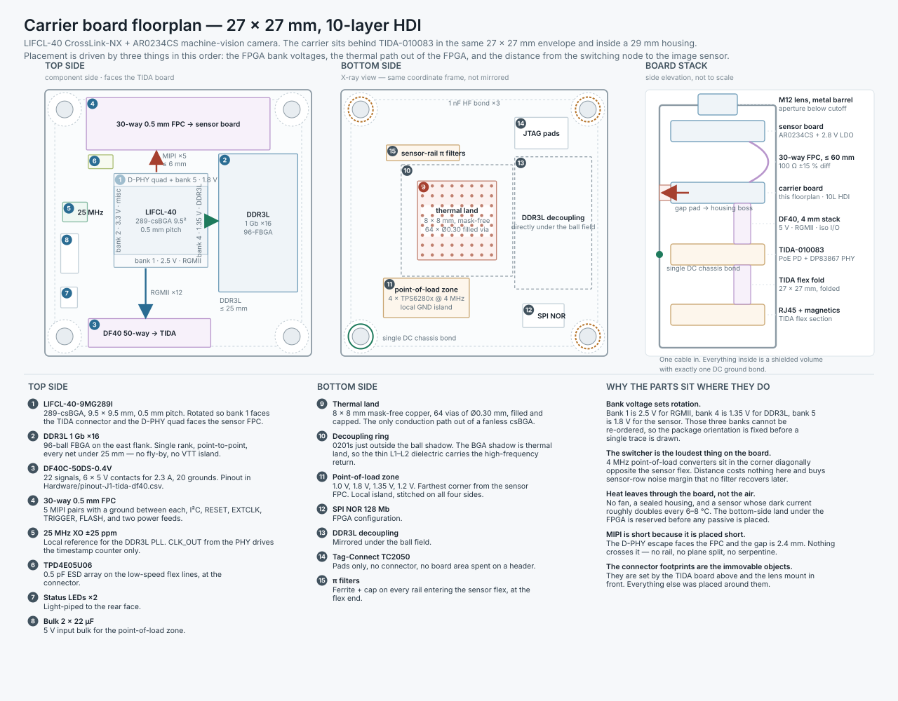
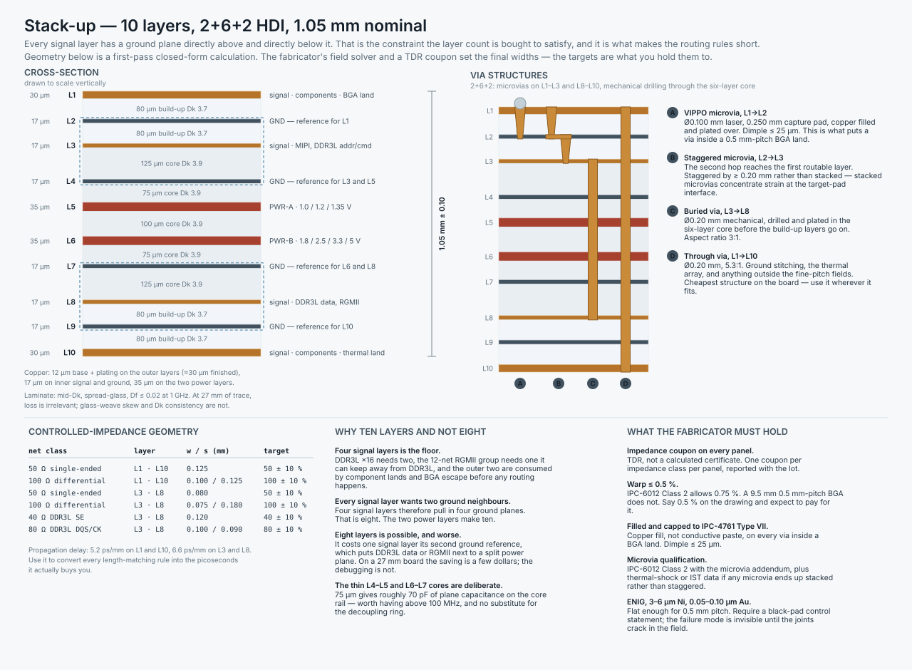
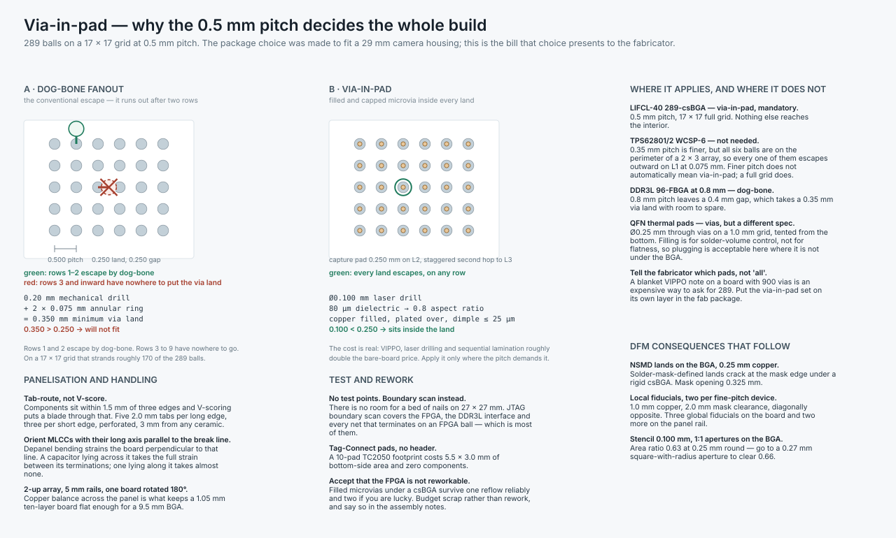
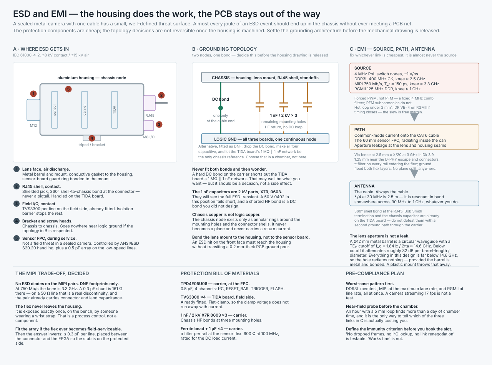

# PCB implementation — the carrier board

**Part 4 of the TIDA-010083 review.** Parts 1 and 2 live in [`../README.md`](../README.md); the RTL is Part 3, in [`../FPGA/README.md`](../FPGA/README.md). Parts 5 to 8 continue from here: [Hardware](../Hardware/README.md), [Optics](../Optics/README.md), [Mechanical](../Mechanical/README.md), [Verification](../Verification/README.md). Part 1 read TI's reference design as a specification. Part 2 chose the parts that satisfy it. This part commits those choices to copper and says what it costs.

Nothing here is simulated. Every impedance number is a closed-form first pass, every thermal number is an estimate, and both are labelled as such. The value of this document is not the numbers — it is the ordering of the decisions, because on a board this size the order is what determines whether it closes at all.

---

## Table of contents

1. [What this part adds, and what it inherits](#1-what-this-part-adds-and-what-it-inherits)
2. [Floorplan](#2-floorplan)
3. [Stack-up](#3-stack-up)
4. [Impedance and length matching](#4-impedance-and-length-matching)
5. [Via-in-pad](#5-via-in-pad)
6. [DFM, DFA and DFT](#6-dfm-dfa-and-dft)
7. [Thermal](#7-thermal)
8. [ESD and EMI](#8-esd-and-emi)
9. [Review notes on Parts 1 and 2](#9-review-notes-on-parts-1-and-2)
10. [Interview readiness — what this repo covers and what it still does not](#10-interview-readiness--what-this-repo-covers-and-what-it-still-does-not)
11. [File manifest and references](#11-file-manifest-and-references)

---

## 1. What this part adds, and what it inherits

### Inherited, unchanged

| From | What |
|---|---|
| Part 1 | TIDA-010083 supplies 5 V at up to 2.3 A, +VIO at 2.5 V, RGMII, MDIO, RESET_N, INT/PWDN, CLK_OUT and four isolated field I/O. 27 × 27 mm. |
| Part 2 | LIFCL-40-9MG289I, AR0234CS, 1 Gb ×16 DDR3L, 128 Mb SPI NOR, TPS6280x point-of-load, TPS7A20 for the sensor analogue rails. |
| FPGA README | Bank 1 at 2.5 V (RGMII), bank 2 at 3.3 V (misc), bank 4 at 1.35 V (DDR3L), bank 5 at 1.8 V (sensor control). ~81 user I/O of 180. |

### Added here

- A 27 × 27 mm carrier-board floorplan, both sides, plus the four-board stack.
- A 10-layer 2+6+2 HDI stack-up with controlled-impedance geometry for every net class.
- Length-matching budgets derived from the actual timing, not copied from a generic app note.
- A via-in-pad specification written the way a fabricator needs to read it.
- DFM, DFA and DFT rules, including the panelisation that a 27 mm board with parts 1.5 mm from three edges actually requires.
- A thermal path, because a fanless csBGA in a sealed housing next to a temperature-sensitive sensor does not get one by accident.
- An ESD and EMI architecture, with the grounding topology settled and the alternative left as a fitted option.

### One change to Part 2

The TPS7A20 LDO for VAA and VAA_PIX **moves to the sensor board**. An LDO's power-supply rejection is a property of the loop at the load. Putting 60 mm of flex between the regulator and the pixel array discards most of it and turns the flex into the dominant noise-injection path. The carrier sends the sensor board a filtered 3.3 V and a filtered 1.8 V; the sensor board makes its own 2.8 V, 20 mm from the array.

---

## 2. Floorplan



### 2.1 The board this describes

27 × 27 mm, 10 layers, 1.05 mm thick, four M1.6 mounting holes on a 23 mm square. It is the second of four boards in a 29 mm housing:

```
lens mount ─ sensor board ─┤FPC├─ carrier board ─┤DF40├─ TIDA PHY board ─┤flex├─ RJ45 + magnetics
```

The sensor lives on its own board for an optical reason, not an electrical one. A 3.0 µm pixel needs the array aligned to the lens mount to a tolerance the main board's mechanical stack cannot hold, and the sensor board must be adjustable after assembly. Everything else follows: the MIPI link becomes a flex, the flex becomes a controlled-impedance part, and the sensor's analogue rails become the sensor board's problem.

### 2.2 The placement order

Three constraints, applied in this order. Each one removes degrees of freedom from the next.

**First: the FPGA's bank voltages fix the package rotation.** Bank 1 must be 2.5 V for RGMII, bank 4 must be 1.35 V for DDR3L, bank 5 must be 1.8 V for the sensor. Those banks are physically where they are on the die, so once you know which peripheral sits on which edge of the board, the package orientation is determined. It is determined *before a single trace exists*, and getting it wrong is a re-spin, not a re-route. So: TIDA connector south, bank 1 faces it; sensor FPC north, D-PHY quad and bank 5 face it; DDR3L east, bank 4 faces it; everything else west.

**Second: the thermal path claims the bottom side under the FPGA.** Section 7 has the arithmetic. The conclusion is that an 8 × 8 mm mask-free land with a 64-via array is the difference between a junction at 72 °C and a junction at 102 °C, and the industrial part is rated to 100 °C T<sub>J</sub>. That area is reserved before any passive is placed, which is why the decoupling sits in a ring around the ball shadow rather than inside it.

**Third: the switching converters go as far from the sensor flex as the board allows.** Four 4 MHz point-of-load converters in the south-west corner, sensor FPC on the north edge. On a 27 mm board the maximum separation available is about 20 mm. It is free, and no filter recovers noise you could have avoided by moving a part.

### 2.3 Top side

| # | Part | Notes |
|---|---|---|
| 1 | LIFCL-40-9MG289I | 289-csBGA, 9.5 × 9.5 mm, 0.5 mm pitch. Centred, rotated as above. |
| 2 | DDR3L 1 Gb ×16 | 96-ball FBGA on the east flank. Single rank, single device, point-to-point. |
| 3 | DF40C-50DS-0.4V | To the TIDA board. 22 signals, 6 × 5 V contacts for the 2.3 A, 20 grounds. Full pinout in [`../Hardware/pinout-J1-tida-df40.csv`](../Hardware/pinout-J1-tida-df40.csv). |
| 4 | 30-way 0.5 mm FPC | To the sensor board. 5 MIPI pairs with a ground conductor between each (16), I²C (2), RESET_BAR, EXTCLK, TRIGGER, FLASH (4), and two filtered rails with returns (8). Pinout in [`../Hardware/pinout-J2-sensor-fpc.csv`](../Hardware/pinout-J2-sensor-fpc.csv). |
| 5 | 25 MHz XO, ±25 ppm | See below. |
| 6 | TPD4E05U06 | 0.5 pF ESD array on the low-speed flex lines, at the connector. |
| 7 | Status LEDs ×2 | Light-piped to the rear face. |
| 8 | Bulk 2 × 22 µF | 5 V input bulk for the point-of-load zone. |

**The crystal Part 2 deleted needs to come back.** Part 2 makes an elegant argument for taking the board reference from the PHY's CLK_OUT — a network-locked 25 MHz that removes an oscillator and gives IEEE 1588 traceability for free. That argument is correct for the timestamp counter and wrong for DDR3L. CLK_OUT ÷5 is a clock recovered by a CDR from twisted pair. Its long-term frequency accuracy is excellent; its short-term jitter and wander are not specified for use as a memory-controller PLL reference, and there is no clock at all until the link comes up, which is after the FPGA has configured and long after the DDR3L controller needs to calibrate.

So: a 25 MHz ±25 ppm oscillator drives the system and DDR3L PLLs. CLK_OUT drives a separate counter that timestamps frames. This costs 2.5 × 2.0 mm and one rail, and it removes an entire class of intermittent DDR3L failure that would otherwise only appear on a long cable to a noisy switch.

### 2.4 Bottom side

| # | Part | Notes |
|---|---|---|
| 9 | Thermal land | 8 × 8 mm, mask-free, 64 × Ø0.30 mm filled and capped vias on a 1.0 mm grid, gap pad to a machined housing boss. |
| 10 | Decoupling ring | 34 × 0201, immediately outside the ball shadow, ≤ 1.2 mm from the nearest power ball. |
| 11 | Point-of-load zone | 1.0 V core, 1.8 V VCCAUX/IO, 1.35 V DDR3L, 1.2 V sensor digital. Local ground island, stitched on all four sides. |
| 12 | SPI NOR 128 Mb | FPGA configuration. |
| 13 | DDR3L decoupling | Mirrored directly under the DDR3L ball field. |
| 14 | Tag-Connect TC2050 | Pads only. No connector, no board area spent on a header. |
| 15 | π filters ×4 | Ferrite bead plus 1 µF on every rail entering the sensor flex, placed at the flex end. |

**The decoupling compromise, stated openly.** Conventional practice puts 0201s on the bottom side directly under the BGA's power/ground ball pairs, because that is the shortest loop available. The thermal land takes that area. The mitigation is the 80 µm L1–L2 dielectric: at that spacing the plane pair under the package is itself a low-inductance capacitor, and the loop from a ball to L2 and back is a pair of microvias. The perimeter ring covers the mid-frequency range and the on-die capacitance covers the top.

This is a real trade and an interviewer should push on it. **[Part 5 §3](../Hardware/README.md#3-power-distribution-network) now runs the numbers, and the trade is comfortable:** the ring as floorplanned reaches 36 mΩ at 200 MHz against a 100 mΩ target, moving the capacitors inside the shadow would buy only 11 mΩ, and deleting the ring entirely would give 121 mΩ and fail. The thermal land is worth far more than 11 mΩ. The fallback — shrinking the land to 6 × 6 mm and putting a first ring of 0201s inside the shadow, at a cost of about 4 °C — stays on the shelf, unused.

### 2.5 What this floorplan forecloses

- **A second sensor.** Part 2 correctly notes the second D-PHY quad is free. There is no second FPC footprint on this board and no room to add one. Stereo needs a 34 × 34 mm carrier or a different housing.
- **Rework of the FPGA.** Section 6.4.
- **A bigger DRAM.** The 8 × 14 mm 96-FBGA is already most of the east flank. A second device, or a 2 Gb part in a larger package, does not fit.
- **Bench probing of DDR3L.** Every data net is a stripline on L3 or L8 between two ground planes with no via to the surface. That is the right SI decision and it means the only DDR3L visibility you get is the FPGA's own read-training results. Build that telemetry into the RTL.

---

## 3. Stack-up



### 3.1 The build

10 layers, 2+6+2 HDI, 1.05 mm ± 0.10 nominal.

| Layer | Copper | Function | Dielectric below |
|---|---|---|---|
| L1 | 30 µm | signal, components, BGA lands | 80 µm build-up, Dk 3.7 |
| L2 | 17 µm | **GND** — reference for L1 | 80 µm build-up, Dk 3.7 |
| L3 | 17 µm | signal — MIPI, DDR3L address/command | 125 µm core, Dk 3.9 |
| L4 | 17 µm | **GND** — reference for L3 and L5 | 75 µm core, Dk 3.9 |
| L5 | 35 µm | PWR-A — 1.0 V, 1.2 V, 1.35 V | 100 µm core, Dk 3.9 |
| L6 | 35 µm | PWR-B — 1.8 V, 2.5 V, 3.3 V, 5 V | 75 µm core, Dk 3.9 |
| L7 | 17 µm | **GND** — reference for L6 and L8 | 125 µm core, Dk 3.9 |
| L8 | 17 µm | signal — DDR3L data, RGMII | 80 µm build-up, Dk 3.7 |
| L9 | 17 µm | **GND** — reference for L10 | 80 µm build-up, Dk 3.7 |
| L10 | 30 µm | signal, components, thermal land | — |

Outer copper is 12 µm base plus plating, finishing near 30 µm. Inner signal and ground are ½ oz. The two power layers are 1 oz because the 5 V input path carries up to 2.3 A across the board.

### 3.2 Why ten and not eight

Four signal layers is the floor. DDR3L ×16 needs two routing layers, RGMII needs one it can keep physically away from DDR3L, and L1 and L10 are consumed by component lands and BGA escape before any routing happens.

Every signal layer wants a ground plane above and below it. Four signal layers therefore pull in four ground planes — that is eight — and the two power layers make ten.

Eight layers is possible and worse. It costs one signal layer its second ground reference, which puts either DDR3L data or RGMII adjacent to a split power plane. On a 27 mm board the bare-board saving is a few dollars per unit at volume. The debugging is not.

### 3.3 Reference-plane discipline

The whole point of the arrangement above is that **it makes the routing rules short**:

1. Every signal layer has solid ground on both sides. There is no legal way to route a signal over a plane split, because the planes a signal can see are all ground.
2. A layer change within a reference pair (L3 ↔ L8 is not one; L1 ↔ L3 is) needs no stitching via. A layer change across a pair needs a ground stitching via within 0.5 mm, two for a differential pair.
3. The two power layers are in the middle, furthest from every signal layer and from both surfaces. Rail islands can be shaped freely on L5 and L6 without anyone needing to check what is above or below them.
4. The thin L4–L5 and L6–L7 cores at 75 µm give roughly 70 pF of interplane capacitance on the core rail. That is worth having above 100 MHz and it is not a substitute for the decoupling ring. Do not let anyone tell you otherwise.

**The one compromise:** L2 is perforated under the FPGA, because every signal ball's microvia needs an isolated pad and antipad in that plane. Under a 9.5 mm 289-ball package that is a lot of holes. The mitigation is that L3's *other* reference, L4, is solid there, and that antipads are held to 0.40 mm. Note it on the fab drawing so nobody "helpfully" enlarges them.

### 3.4 Laminate

Mid-Dk, spread-glass, Df ≤ 0.02 at 1 GHz. At a maximum trace length of 27 mm, dielectric loss is irrelevant — at 3 GHz the entire board is well under 0.5 dB. What matters is **glass-weave skew** on the differential pairs and **Dk consistency** panel to panel. Specify spread or flat glass (1078, 1067, or equivalent) rather than standard 1080, and route differential pairs at a small angle to the weave, or zig-zag them, if the fabricator cannot guarantee spread glass.

---

## 4. Impedance and length matching

### 4.1 Net classes and geometry

Machine-readable in [`../Hardware/net-classes.csv`](../Hardware/net-classes.csv). First-pass closed-form values. **The fabricator's field solver and a TDR coupon set the final widths.** What you hold them to is the target and the tolerance, not the geometry.

| Net class | Where | Layer | w / s (mm) | Target |
|---|---|---|---|---|
| 50 Ω single-ended | general, control | L1 · L10 | 0.125 | 50 Ω ± 10 % |
| 100 Ω differential | MIPI D-PHY | L1 · L10 | 0.100 / 0.125 | 100 Ω ± 10 % |
| 50 Ω single-ended | general | L3 · L8 | 0.080 | 50 Ω ± 10 % |
| 100 Ω differential | MIPI if it must go inner | L3 · L8 | 0.075 / 0.180 | 100 Ω ± 10 % |
| 40 Ω single-ended | DDR3L DQ, ADDR/CMD | L3 · L8 | 0.120 | 40 Ω ± 10 % |
| 80 Ω differential | DDR3L DQS, CK | L3 · L8 | 0.100 / 0.090 | 80 Ω ± 10 % |

**Why 40 Ω and not 50 Ω for DDR3L.** The DDR3L driver's calibrated output impedance is 34 Ω and the on-die termination options are 40, 60 and 120 Ω. A 40 Ω trace lands between the driver and the most commonly selected ODT setting, which minimises the reflection at both ends. 50 Ω works and is what you fall back to if the fabricator cannot hold two single-ended widths on one layer — but then run the ODT sweep during bring-up rather than assuming the default is right.

**MIPI goes on L1.** The D-PHY escape faces the FPC connector and the gap is 2.4 mm. There is no reason to send those pairs inner, and every reason not to: a microstrip pair on L1 with a solid L2 beneath it has no via transitions at all between the BGA land and the connector land. The inner-layer geometry is in the table only as a fallback.

**Loose coupling on the inner differential pairs is deliberate.** 0.075 / 0.180 is a spacing well over 2 × width. Loosely coupled pairs are far less sensitive to etch and registration variation than tightly coupled ones, and on a board where the fabricator is already being asked for filled microvias and 0.5 % warp, spending manufacturing tolerance on differential coupling is a poor allocation.

### 4.2 Propagation delay

| Layer type | Delay |
|---|---|
| L1 · L10 microstrip, Dk 3.7 | **5.2 ps/mm** |
| L3 · L8 stripline, Dk 3.9 | **6.6 ps/mm** |

Every length rule below converts through these. Quote both numbers in the review so the discussion is about picoseconds of margin rather than millimetres of tradition.

### 4.3 Length matching

| Group | Rule | In ps | Why |
|---|---|---|---|
| MIPI pair, intra-pair | ± 0.05 mm | ± 0.3 ps | Skew converts directly into common-mode, which is what radiates. |
| MIPI lane to clock | ± 2.5 mm | ± 13 ps | 0.01 UI at 750 Mb/s. The receiver deskews per lane; this is comfort, not necessity. |
| DDR3L DQ to its DQS | ± 0.6 mm | ± 4 ps | Within a byte lane only. |
| DDR3L DQS / CK intra-pair | ± 0.13 mm | ± 0.9 ps | |
| DDR3L byte lane to byte lane | ± 5 mm | ± 33 ps | Per-lane DQS means the lanes do not need to match each other. |
| DDR3L ADDR/CMD to CK | ± 2.5 mm | ± 17 ps | Single device, point-to-point, no fly-by. |
| RGMII within TX group to GTX_CLK | ± 2.5 mm | ± 17 ps | See below. |
| RGMII within RX group to RX_CLK | ± 2.5 mm | ± 17 ps | Match each group to *its own* clock, never to each other. |

**The single most important RGMII rule is not a length rule.** Part 1 §5 states it: pick *one* source of the quarter-cycle delay. The PHY is put into Shift mode by `phy_init`, so the board adds **no** extra clock length. Doing both double-shifts the clock, which breaks gigabit while 100 Mb/s keeps working — a failure that looks like a cable problem and is not.

### 4.4 Termination

**DDR3L: no VTT island, no fly-by topology.** One rank, one device, every net under 25 mm. At 800 MT/s a 25 mm stripline is 165 ps one way — about 0.13 UI — so the net behaves as a lumped load rather than a transmission line for address and command. DQ and DQS are handled by ODT at both ends. This deletes a VTT regulator, a VTT plane island, a row of termination resistors and about 15 mm² of board area from a board that has none to spare.

The honest caveat: this must be confirmed by simulation with the real IBIS models before release, particularly the address/command overshoot with no series termination. If the overshoot exceeds the DDR3L absolute maximum, the fix is 22 Ω series resistors at the FPGA on address and command, and there is room for them.

**800 MT/s is a choice, not a limit.** The device supports 1066 Mb/s. The bandwidth requirement is 2.76 Gb/s in from the sensor plus 0.95 Gb/s out to Ethernet — 3.7 Gb/s. A ×16 bus at 800 MT/s is 12.8 Gb/s raw, and even at 50 % efficiency after refresh, turnaround and page misses it is 6.4 Gb/s. Running slower than the part allows buys timing margin on the only interface in the design that is near a wall.

### 4.5 Spacing

| Between | Minimum |
|---|---|
| Nets within a class | 3 × dielectric height |
| MIPI pair to any other net | 5 × dielectric height, or a different layer with ground between |
| Any signal to a switching node's copper | 1.0 mm on the same layer, and never directly above or below it |
| MIPI group to RGMII group | 1.5 mm, or different layers |
| Any net to board edge | 1.0 mm, inside the via fence |

### 4.6 Ground stitching

Via fence around the entire board perimeter and around each connector at **2.5 mm pitch**, tightening to **1.25 mm** along the D-PHY escape and the two connector shells.

The number is derived, not inherited. The highest frequency worth controlling is the knee of the fastest edge on the board: MIPI at T<sub>r</sub> ≈ 150 ps gives f<sub>knee</sub> = 0.5 / T<sub>r</sub> ≈ 3.3 GHz. At 3 GHz in Dk 3.9, λ = c / (f √εr) = 50.6 mm, and λ/20 = 2.5 mm. Write the derivation on the drawing so the spacing survives the next reviewer who thinks 5 mm looks tidier.

### 4.7 The flex

The sensor flex is a controlled-impedance part and must be specified as one.

| Parameter | Value |
|---|---|
| Construction | 2-layer, signal over solid ground, 100 µm polyimide core, 12 µm copper, 25 µm coverlay |
| Differential geometry | 0.150 mm trace / 0.110 mm gap, first pass |
| Target | 100 Ω ± 15 % |
| Ground | One conductor between every pair on the signal layer, plus a solid plane on layer 2 |
| Length | ≤ 60 mm |
| Bend | Static bend only, radius ≥ 10 × thickness, with a stiffener under each ZIF end |

The conductors must neck to 0.5 mm pitch at each ZIF contact. That is an impedance discontinuity roughly 2 mm long. At a 150 ps rise time the electrical length of 2 mm is about 10 ps, well under a tenth of the edge, so it is tolerable — but it is the reason the flex tolerance is ± 15 % and not ± 10 %.

---

## 5. Via-in-pad



### 5.1 Why it is forced

The LIFCL-40 289-csBGA is a full 17 × 17 grid on a 0.5 mm pitch. With a 0.25 mm land, the gap between adjacent lands is 0.25 mm.

```
0.20 mm mechanical drill
+ 2 × 0.075 mm annular ring
= 0.350 mm minimum via land

0.350 mm  >  0.250 mm gap   →   a dog-bone will not fit
```

Rows 1 and 2 escape conventionally. Rows 3 inward have nowhere to put the via land. On a 17 × 17 grid that strands roughly 170 of 289 balls. The only way in is a via that lives *inside* the land — Ø0.100 mm laser, which fits a 0.250 mm land with 0.075 mm of copper all round.

This is not an incidental consequence. It is the direct price of the package choice made in the FPGA README to fit a 29 mm housing, and it roughly doubles the bare-board cost. Both halves of that trade should be stated together whenever the package decision is defended.

### 5.2 Where it applies, and where it does not

| Device | Pitch | Verdict |
|---|---|---|
| LIFCL-40 289-csBGA | 0.5 mm, full grid | **Via-in-pad, mandatory.** Nothing else reaches the interior. |
| TPS62801/2 WCSP-6 | 0.35 mm, 2 × 3 | **Not needed.** Finer pitch, but all six balls are on the perimeter and every one escapes outward on L1 at 0.075 mm. |
| DDR3L 96-FBGA | 0.8 mm | **Dog-bone.** A 0.4 mm gap takes a 0.35 mm via land with room to spare. |
| QFN thermal pads | — | Vias, but a different specification: Ø0.25 mm through vias on a 1.0 mm grid, tented from the bottom. Plugging is for solder-volume control here, not flatness. |

The row that matters is the second one. **Pitch alone does not force via-in-pad; a populated interior does.** It is a distinction worth being able to make quickly, because it is the difference between a two-dollar board and a five-dollar board on the regulator section.

### 5.3 What to write on the fab drawing

```
VIA-IN-PAD, filled and capped, per IPC-4761 Type VII:

  Structure          Ø0.100 mm laser microvia, L1→L2
  Capture pad        0.250 mm on L2 (minimum target land 0.300 mm)
  Dielectric         80 µm  →  aspect ratio 0.8
  Fill               COPPER, electroplated.  Conductive or non-conductive
                     epoxy fill is NOT acceptable under the BGA.
  Planarisation      dimple ≤ 25 µm, protrusion ≤ 50 µm
  Second hop         L2→L3, STAGGERED by ≥ 0.20 mm from the L1→L2 via.
                     Stacked microvias permitted only with IPC-6012
                     microvia-addendum qualification plus IST or
                     thermal-shock data for this stack-up.
  Applies to         the 289 lands of U1 only — see layer VIPPO_SET.
                     Do NOT apply to any other via on the board.
```

Three of those lines exist because of a specific failure mode:

- **Copper fill, not epoxy.** Epoxy fill has a coefficient of thermal expansion an order of magnitude away from copper. Under a rigid csBGA it pumps during reflow and thermal cycling and shows up as voided or cracked joints months later.
- **Dimple ≤ 25 µm.** A deeper dimple swallows solder paste, reduces the joint volume and produces a head-in-pillow defect that passes AOI and fails on the customer's bench.
- **Staggered, not stacked.** Stacked microvias concentrate strain at the target-pad interface of the lower via. The industry has documented this at length (IPC-WP-023); the failure is a latent open that appears after thermal cycling, which is exactly the worst place to find it in a sealed industrial camera.

- **"Applies to U1 only."** A blanket via-in-pad note on a board with roughly 900 vias is an expensive way to ask for 289. Put the set on a dedicated layer in the fab package and reference it by name.

---

## 6. DFM, DFA and DFT

### 6.1 Feature set

| Attribute | Value |
|---|---|
| Line / space, inner | 0.075 / 0.075 mm |
| Line / space, outer | 0.100 / 0.100 mm |
| Mechanical drill, minimum | 0.200 mm (5.3 : 1 aspect through the full board) |
| Annular ring, mechanical | 0.075 mm |
| Annular ring, microvia capture | 0.075 mm |
| Soldermask dam, minimum | 0.075 mm — below this, specify no dam and control by paste |
| Soldermask expansion, SMD | 0.050 mm per side |
| BGA lands | **NSMD**, 0.250 mm copper, 0.325 mm mask opening |
| Surface finish | ENIG, Ni 3–6 µm, Au 0.05–0.10 µm |
| Class | IPC-6012 Class 2, plus Class 3 annular ring and 25 µm minimum hole plating |
| Warp | **≤ 0.5 %** (Class 2 allows 0.75 %; a 9.5 mm 0.5 mm-pitch BGA does not) |
| Impedance control | TDR coupon, one per impedance class per panel, reported with the lot |

NSMD on the BGA rather than SMD: a solder-mask-defined land puts the stress riser at the mask edge, and under a rigid csBGA that is where the joint cracks. The 0.075 mm dam rule is why the mask opening is 0.325 mm — at 0.5 mm pitch there is exactly 0.175 mm between adjacent openings, which is a dam of 0.175 mm. Comfortable.

### 6.2 Panelisation

**Tab-route, not V-score.** Components sit within 1.5 mm of three edges and a V-score blade goes straight through that zone. Five 2.0 mm perforated tabs per long edge, three per short edge.

**2-up array, 5 mm rails, one board rotated 180°.** The rotation is for copper balance: a 1.05 mm ten-layer board with a thermal land on one side and a connector cluster on the other is asymmetric, and asymmetry across a panel is what produces the warp that a 0.5 mm-pitch BGA cannot tolerate.

**Orient every MLCC with its long axis parallel to the break line.** Depanel bending strains the board perpendicular to the break line. A capacitor lying across that direction takes the full strain between its two terminations and cracks; one lying along it takes almost none. Keep every ceramic ≥ 3 mm from a tab in any case.

### 6.3 Assembly

| Item | Value |
|---|---|
| Fiducials, global | 3 on the board, 1.0 mm copper, 2.0 mm mask clearance |
| Fiducials, local | 2 per fine-pitch device, diagonally opposite |
| Fiducials, panel | 2 on the rail |
| Stencil | 0.100 mm laser-cut, electropolished |
| BGA apertures | 0.27 mm rounded square → area ratio 0.675. A 0.25 mm round gives 0.625 and releases badly |
| Process | Double-sided reflow. Heavy parts and connectors top side, first pass |
| Edge keep-out | 1.0 mm to any component body |

### 6.4 Test

**No test points, and no apology for it.** There is no room for a bed of nails on 27 × 27 mm, and adding one would cost more board area than the coverage is worth. Instead:

- **JTAG boundary scan** covers the FPGA, the DDR3L interface and every net terminating on an FPGA ball — which is most of the nets on the board.
- **A Tag-Connect TC2050 footprint** gives JTAG access for 5.5 × 3.0 mm of bottom-side pads and zero components.
- **Functional test is the real test.** Part 1 §8 describes it: reverse loopback via BISCR 0x0016 = 0x0020 exercises the RJ45, magnetics and analogue front end from a PC with no MAC. Add an FPGA self-test that runs a DDR3L memtest, reports the read-training window, and streams a test pattern through the full ISP and GVSP path.
- **Report the DDR3L training margin over the production interface.** Section 2.5 explains why: there is no other way to see it.

**Accept that the FPGA is not reworkable.** Filled microvias under a csBGA survive one reflow reliably and a second if you are lucky. Budget scrap rather than rework and put that in the assembly notes, so the decision is made once by engineering rather than repeatedly by whoever is holding the hot-air station.

### 6.5 Fab drawing checklist

- [ ] Stack-up table with layer order, copper weights, dielectric thicknesses and materials by name
- [ ] Impedance table with target, tolerance, layer, and geometry — and a note that geometry may be adjusted to hit the target
- [ ] TDR coupon required, one per class per panel, report with the lot
- [ ] Via table: every structure, drill, pad, plating, fill
- [ ] VIPPO note referencing the `VIPPO_SET` layer, not "all vias"
- [ ] Microvia staggering requirement and the qualification demanded if stacked
- [ ] Warp ≤ 0.5 %
- [ ] Antipad 0.40 mm under U1, with an explicit "do not enlarge"
- [ ] Spread-glass laminate called out by style
- [ ] Surface finish with thickness range and a black-pad control statement
- [ ] IPC-6012 class, with the Class 3 exceptions listed individually
- [ ] Panel drawing with tab positions, rails and fiducials
- [ ] Chassis-ground annular rings identified as chassis, not logic ground

---

## 7. Thermal

*The mechanical side of this — the gap pad, the boss, and the sealing it has to survive — is [Part 7](../Mechanical/README.md).*

No fan, no heatsink, a sealed aluminium housing, and a CMOS sensor whose dark current roughly doubles every 6–8 °C. Thermal design here is an imaging specification, not a reliability one.

### 7.1 The arithmetic

Estimates. Run the Lattice Power Calculator and a real thermal model before you believe them.

| | Without thermal land | With thermal land |
|---|---|---|
| FPGA dissipation | 1.5 W (Part 2 upper estimate) | 1.5 W |
| Effective θ<sub>JA</sub> | ≈ 35 °C/W | ≈ 15 °C/W |
| Rise | 52 °C | 22 °C |
| Internal ambient | 50 °C | 50 °C |
| **T<sub>J</sub>** | **≈ 102 °C** | **≈ 72 °C** |
| Industrial limit | 100 °C | 100 °C |
| Verdict | **fails** | 28 °C of margin |

Internal ambient of 50 °C assumes 40 °C external plus self-heating of the sealed volume — dominated by the TIDA board's flyback, not by the carrier.

### 7.2 The path

FPGA junction → package substrate → ball field → 64 filled vias → bottom-side land → thermal gap pad → machined boss on the housing wall → housing → ambient.

Every element of that chain is a placement decision made in section 2, which is why the thermal land was reserved before the passives.

### 7.3 Keeping the sensor out of it

The sensor board's only conduction path to the carrier is the flex, which is deliberately thin copper, and the lens-mount casting, which is bonded to the housing rather than to the carrier. The sensor should run near housing temperature, not near FPGA temperature.

Two consequences worth stating: do not add a copper pour to the flex for "better grounding" — it is also a thermal bridge — and do not mount the sensor board to the same standoffs as the carrier if those standoffs are the carrier's heat path.

---

## 8. ESD and EMI



### 8.1 The threat surface is small, which is the whole advantage

A sealed metal camera with one cable has five ESD entry points and one EMI antenna. That is a small enough list to handle completely rather than defensively.

| # | Entry | Handled by |
|---|---|---|
| 1 | Lens face, air discharge | Metal barrel and mount, conductive gasket to the housing, sensor-board guard ring bonded to the mount |
| 2 | RJ45 shell, contact | Shielded jack, 360° shell-to-chassis bond at the connector — never a pigtail. On the TIDA board |
| 3 | Field I/O, contact | TVS3300 per line on the field side, already fitted. The isolation barrier stops the rest |
| 4 | Bracket and screw heads | Chassis to chassis, provided the topology in 8.2 is respected |
| 5 | Sensor FPC, during service | ANSI/ESD S20.20 handling, plus a 0.5 pF array on the low-speed lines |

Test level: IEC 61000-4-2, ± 8 kV contact and ± 15 kV air, which is what EN 61326-1 expects of industrial equipment.

### 8.2 Grounding topology — decide this before the housing drawing

Two nodes, and only two:

- **CHASSIS** — the housing, the lens mount, the RJ45 shell, all four standoffs. It exists on the PCB only as annular rings around the mounting holes and the connector shells. It never becomes a plane and it never carries a return current.
- **LOGIC GND** — all three boards, one continuous node.

**Default: one DC bond, at the corner nearest the cable entry.** The remaining three mounting holes get 1 nF / 2 kV X7R 0603 capacitors, which give a high-frequency return without closing a DC loop.

**Alternative, fitted as DNF:** drop the DC bond, make all four capacitive, and let the TIDA board's R44 (1 MΩ) ∥ C54 (1 nF / 2 kV) network be the only chassis reference. Both topologies are defensible for a functionally-isolated PoE camera. The point is to fit both options, choose in an EMC chamber, and document the choice — not to argue about it at the review.

Three rules that follow:

- **Never fit both bonds and then wonder.** A hard DC bond on the carrier shorts out the TIDA board's 1 MΩ ∥ 1 nF network. That may be exactly what you want, but it should be a decision rather than a side effect.
- **The 1 nF capacitors are 2 kV parts.** They see the full ESD transient. A 50 V 0402 in that position fails short, and a shorted HF bond is a DC bond you did not design.
- **Bond the lens mount to the housing, not to the sensor board.** A discharge to the front face must reach the housing without transiting a 0.2 mm-thick PCB ground pour.

### 8.3 The MIPI decision

**No ESD diodes on the MIPI pairs. DNF footprints only.**

At 750 Mb/s per lane the knee frequency is about 3.3 GHz. The impedance of a 0.3 pF shunt there is

```
Z = 1 / (2π · 3.3 GHz · 0.3 pF) ≈ 161 Ω
```

On a 50 Ω line — each half of the 100 Ω pair — that is a real discontinuity, and the pair already carries connector and land capacitance before any diode is added. Meanwhile the flex is inside a sealed housing and is exposed exactly once, on the bench, by someone wearing a wrist strap. That is a process control, not a component.

The decision inverts if the flex ever becomes field-serviceable. Then: ≤ 0.3 pF per line, placed between the connector and the FPGA so the stub is on the protected side, and expect to re-simulate the eye.

### 8.4 EMI — source, path, antenna

Fix whichever link is cheapest. It is almost never the source.

**Sources**, in order of the trouble they cause:

| Source | Knee | Mitigation |
|---|---|---|
| 4 MHz point-of-load switch nodes, ~1 V/ns | ~300 MHz | Forced PWM, not PFM. A fixed 4 MHz comb filters; PFM subharmonics wander and do not. Hot loop under 2 mm² |
| DDR3L 400 MHz CK, 800 MT/s data | ≈ 2.5 GHz | Stripline on L3/L8 between two ground planes. It is buried by construction |
| MIPI 750 Mb/s, T<sub>r</sub> ≈ 150 ps | ≈ 3.3 GHz | Short, on L1, no via transitions, ground between every pair on the flex |
| RGMII 125 MHz DDR, LVCMOS25 | ≈ 1 GHz | `DRIVE=4` instead of `8` if timing closes. Slower edges are free margin |
| PoE flyback, TIDA board | — | Already dithered via DTHR, R38 = 237 kΩ |

**Paths:** common-mode current onto the CAT6 cable (dominant), radiation from the 60 mm sensor flex inside the can, and aperture leakage at the lens and housing seams. Mitigations: the 2.5 mm via fence of section 4.6, π filters on every rail entering the flex, ground flood on both flex layers, and no plane split anywhere — which the stack-up makes structurally impossible.

**Antenna:** the cable. Always the cable. λ/4 at 30 MHz is 2.5 m, so it is resonant somewhere between 30 MHz and 1 GHz no matter what you do. The answer is the 360° shell bond at the RJ45, plus the Bob Smith termination and chassis capacitor already on the TIDA board — and *not* defeating them with a second, unintended ground path through the carrier.

### 8.5 The lens aperture is not a leak

A hole in a Faraday cage is only a leak above the cutoff frequency of the waveguide it forms. A Ø12 mm metal lens barrel is a circular waveguide whose TE₁₁ cutoff is

```
f_c = 1.841 c / (2π a)  with a = 6 mm  →  f_c ≈ 14.6 GHz
```

Below cutoff it attenuates roughly 32 dB per (barrel length / diameter). Everything in this design is an order of magnitude below 14.6 GHz, so the aperture radiates essentially nothing — **provided the barrel and the mount are metal and bonded**. A plastic lens mount throws the entire argument away and turns the aperture into a 12 mm slot antenna. Put that requirement on the mechanical drawing, not just in an email.

### 8.6 Pre-compliance plan

1. **Worst-case pattern first.** DDR3L memtest, MIPI at the maximum lane rate and RGMII at line rate, all at once. A camera streaming 17 fps is not a test.
2. **Near-field probe before the chamber.** An hour with a 5 mm loop finds more than a day of chamber time, and it is the only practical way to tell which of source, path or antenna is costing you.
3. **CISPR 32 / EN 55032 radiated, 30 MHz – 6 GHz.** Class A for an industrial installation; Class B if it might be sold into a commercial environment — decide early, because the margin difference is 10 dB.
4. **IEC 61000-4-2 ESD**, 10 discharges per point, including the lens face, the RJ45 shell, every screw head and every seam.
5. **IEC 61000-4-3 radiated immunity**, 10 V/m, 80 MHz – 6 GHz. **Define the pass criterion before booking the slot:** "no dropped frames, no I²C lockup, no link renegotiation" is testable; "works fine" is not.
6. **IEC 61000-4-4 EFT** ± 1 kV and **61000-4-5 surge** ± 1 kV on the Ethernet cable, **61000-4-6 conducted** 10 V, 150 kHz – 80 MHz.

### 8.7 Protection bill of materials

| Part | Where | Role |
|---|---|---|
| TPD4E05U06 | Carrier, at the FPC | 0.5 pF, 4 channels: I²C, RESET_BAR, TRIGGER, FLASH |
| TVS3300 × 4 | TIDA board, field side | Already fitted. Flat-clamp, so the clamp voltage does not run away with current |
| 1 nF / 2 kV X7R 0603 × 3 | Carrier, mounting holes | Chassis HF bonds |
| Ferrite bead + 1 µF × 4 | Carrier, at the flex | π filter per rail. 600 Ω at 100 MHz, rated for the DC load |
| Conductive gasket | Lens mount and rear panel | Seam control; also the ESD path for entry point 1 |

---

## 9. Review notes on Parts 1 and 2

The existing documents are unusually good — grouped by function rather than schematic page, with the reasoning attached to each number. Four things I would change or question:

**1. `cam_top.pdc` over-constrains RGMII by about 15×.** The file specifies ± 10 mil within each group. RGMII at 125 MHz DDR has a 4 ns half-period; the transmitter skew spec is ± 500 ps and the receiver window is 1.0–2.6 ns. A board contribution of ± 100 ps is already negligible, and ± 100 ps is 15 mm of stripline. **± 100 mil (2.5 mm) is ample** and it releases serpentine area that a 27 × 27 mm board genuinely needs. Tighten a rule when the timing demands it, not when it looks rigorous.

**2. Deleting the oscillator is right for the timestamp and wrong for DDR3L.** Section 2.3 above. The CLK_OUT ÷5 idea is a good one and should stay — for the 1588 counter.

**3. The LDO placement needs to be specified, not just the part.** Part 2 correctly picks a TPS7A20 for VAA and VAA_PIX and correctly explains why a switcher would produce banding. It does not say where the LDO goes, and the answer changes the flex, the connector pin count and the sensor board's BOM. It belongs at the sensor.

**4. The package decision deserves its cost stated alongside it.** The FPGA README argues carefully for the 289-csBGA over the 400-caBGA on housing grounds. That argument is right, and it also commits the project to HDI, laser drilling, sequential lamination and filled via-in-pad — roughly double the bare-board cost and a much smaller set of qualified fabricators. Both halves should appear in the same paragraph.

Everything else I would defend as written.

---

## 10. Interview readiness — what this repo covers and what it still does not

### What a camera hardware interviewer can now walk end to end

| Stage | Where |
|---|---|
| Reading a reference design as a specification | Part 1 §1–9 |
| Power architecture, sequencing, isolation | Part 1 §3–4 |
| Clocking, reset and interrupt discipline | Part 1 §5–7 |
| System part selection with justification | Part 2 §11–12 |
| Bandwidth and power budgets, with the bottleneck named | Part 2 §14–15 |
| RTL architecture and the decision that shapes it | FPGA README §3–4 |
| Floorplan and placement order | Part 4 §2 |
| Stack-up and layer-count justification | Part 4 §3 |
| Impedance, length matching, termination | Part 4 §4 |
| Via-in-pad and HDI economics | Part 4 §5 |
| DFM, DFA, DFT and the fab drawing | Part 4 §6 |
| Thermal, quantified | Part 4 §7 |
| ESD, EMI and the grounding topology | Part 4 §8 |
| Connector-level interface control | Part 5 §1–2 |
| PDN target impedance and decoupling | Part 5 §3 |
| Optical requirements the sensor imposes | Part 6 |
| Focus tolerance stack and the architecture it forces | Part 7 §1 |
| Bring-up order, production test, calibration | Part 8 §1–3 |
| EMC and environmental compliance plan | Part 8 §4 |

### Questions this now answers in one sentence each

- *Why that FPGA package?* Housing. And here is what it cost: HDI, VIPPO, double the bare-board price.
- *Why ten layers?* Four signal layers, each with two ground references, plus two power layers.
- *Where does the heat go?* Through 64 filled vias into a bottom-side land into a gap pad into the housing — 30 °C of junction temperature, so not optional.
- *How do you get a quarter-cycle into RGMII?* PHY Shift mode. Not both.
- *Do you put ESD diodes on MIPI?* No, and here is the 161 Ω that says why.
- *Where is the chassis bond?* One, at the cable end, with the alternative fitted as DNF and the choice made in a chamber.
- *Why no VTT?* One rank, one device, 25 mm nets, ODT at both ends — confirmed by simulation before release.
- *What is the riskiest thing on this board?* Not the PDN any more — Part 5 §3 closed that with 2.8× margin. It is the focus stack, which Part 7 §1 shows is 10× over budget and which the architecture rather than the tolerances has to absorb.

### What is still missing

Be able to say this list out loud. It is more impressive than pretending it is complete.

1. **No schematic or BOM for the carrier.** Part selection is not a schematic. Net-level capture, ratings, tolerances and a costed BOM do not exist.
2. **No signal-integrity simulation.** Every impedance here is closed-form and every length budget is arithmetic. No IBIS, no eye diagrams, no crosstalk analysis, no DDR3L timing closure against the real models.
3. **No synthesis results.** The RTL compiles under `iverilog`; it has not been through Radiant, so utilisation and timing are estimates.
4. **No thermal model.** Section 7 is a hand calculation with an assumed θ<sub>JA</sub>.
5. **No mechanical CAD.** Part 7 does the tolerance stack and the thermal interface; there is still no housing model, no lens mount and no drawing set.
6. **No lens selected and no optical simulation.** Part 6 says how to choose one and what to reject; it names no part, because field of view and working distance are application inputs.
7. **No GenICam XML.** Part 8 §4 — the largest single gap between "it streams" and "a customer can use it."

*Items 3, 6, 7 and 8 of the original list are now covered: the PDN in Part 5 §3, the optics in Part 6, the tolerance stack in Part 7 §1, and calibration, production test and compliance in Part 8.*

---

## 11. File manifest and references

### Diagrams

| File | Contents |
|---|---|
| `diagrams/10-pcb-floorplan.svg` | Top side, bottom side, four-board stack elevation, placement rationale |
| `diagrams/11-stackup.svg` | 10-layer cross-section to scale, via structures, impedance geometry, fab requirements |
| `diagrams/12-bga-escape-and-dfm.svg` | Dog-bone failure at 0.5 mm pitch, via-in-pad, panelisation, test strategy |
| `diagrams/13-esd-emi.svg` | ESD entry points, grounding topology, EMI source–path–antenna chain |

### Standards and documents referenced

| Document | Subject |
|---|---|
| IPC-2221B / IPC-2222 | Generic and rigid printed-board design |
| IPC-2226 | Sectional design standard for HDI |
| IPC-4761 | Via protection — Type VII is filled and capped |
| IPC-6012 (+ microvia addendum) | Qualification and performance of rigid boards |
| IPC-7351 | Land pattern geometry |
| IPC-A-610 | Acceptability of electronic assemblies |
| IPC-WP-023 | Stacked microvia reliability |
| ANSI/ESD S20.20, IEC 61340-5-1 | ESD-protected area, handling |
| IEC 61000-4-2 / -3 / -4 / -5 / -6 | ESD, radiated immunity, EFT, surge, conducted immunity |
| CISPR 32 / EN 55032 | Radiated and conducted emissions |
| EN 61326-1 | EMC for measurement and control equipment |
| JESD79-3F | DDR3 / DDR3L |
| MIPI D-PHY 1.2, CSI-2 1.2 | Sensor interface |

### Caveats

- Every impedance figure is a closed-form estimate using the IPC-2141-style microstrip and stripline approximations. They are adequate for choosing a stack-up and wrong for releasing one. Get the geometry from the fabricator's field solver and prove it with a TDR coupon.
- Thermal numbers assume a θ<sub>JA</sub> that has not been modelled. The conclusion — that the thermal land is the difference between passing and failing — is robust to a wide error band on that assumption, but the absolute temperatures are not.
- Package dimensions for the DDR3L device and the AR0234CS are approximate. Confirm the AR0234CS mechanical drawing for the current orderable, and note that the datum the lens mount is machined to is the **optical centre**, not the package outline.
- Connector part numbers are representative of the right class and pitch, not a validated selection.
- The `VIPPO_SET`, `chassis-ground` and antipad notes in section 6.5 exist because each of them has been "helpfully corrected" by someone downstream on some board, somewhere. Write them down.
