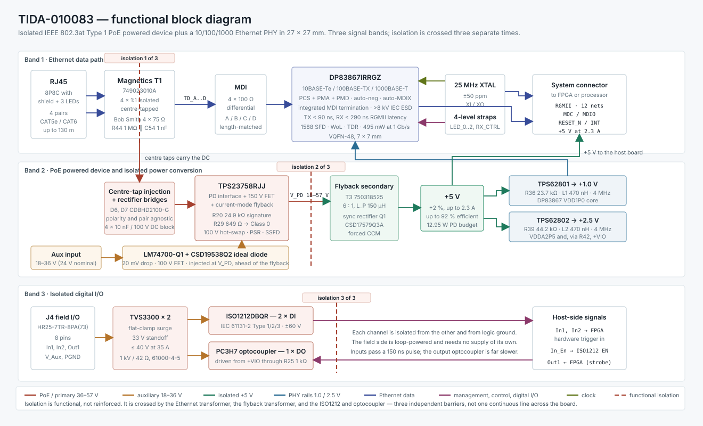
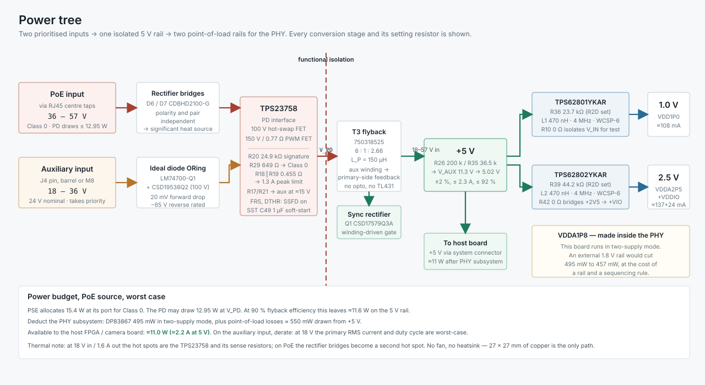
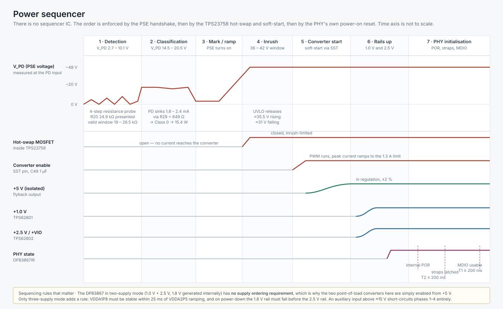
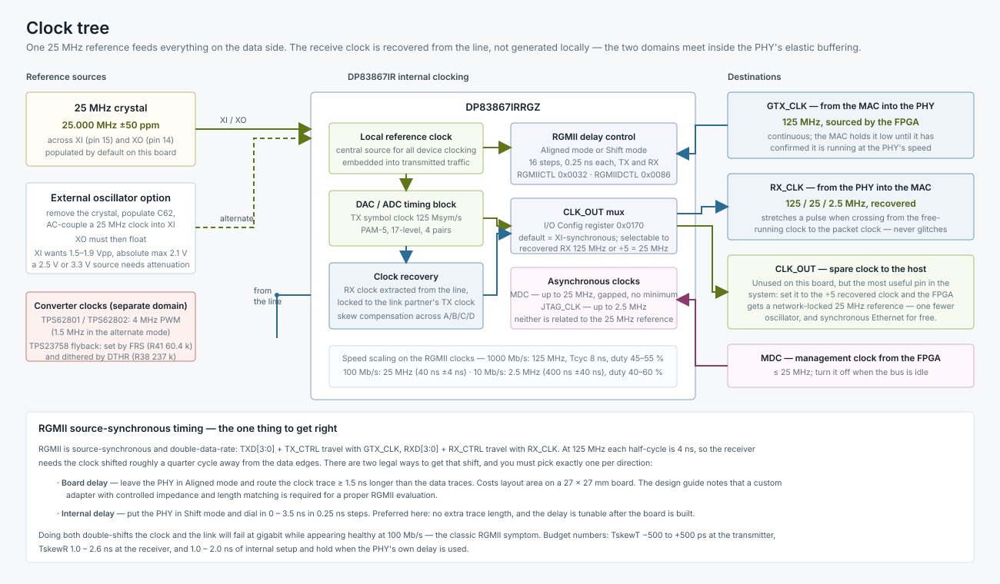
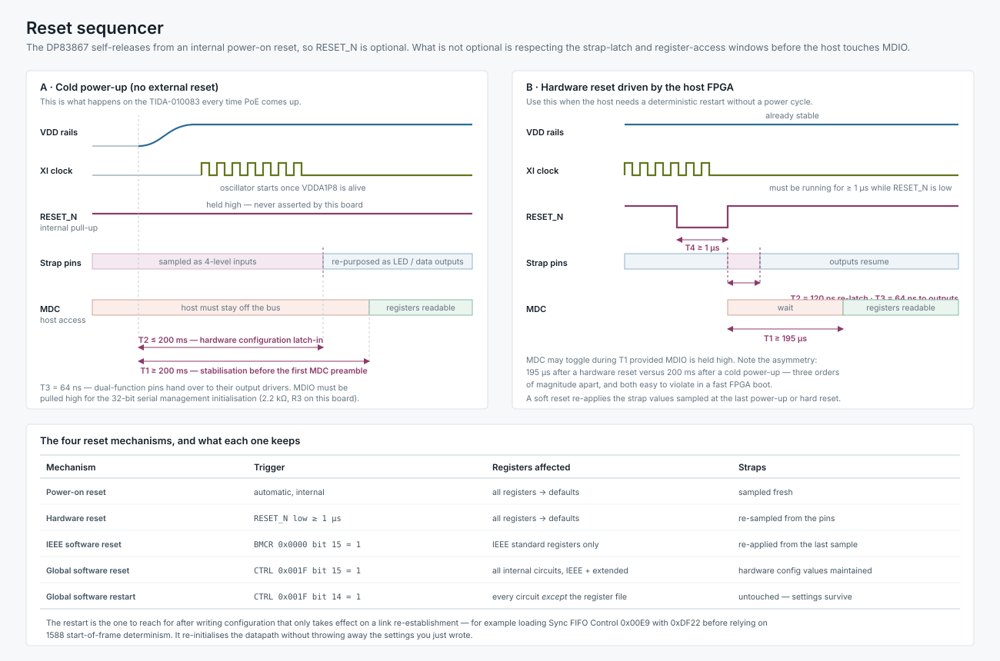
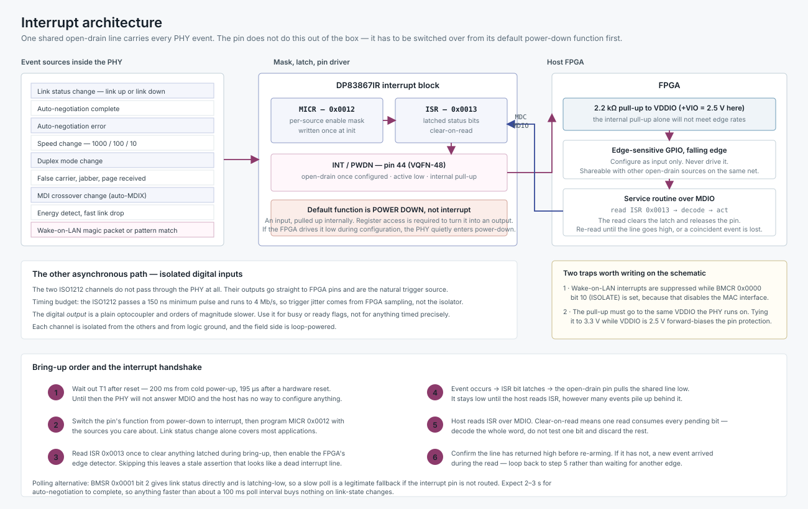
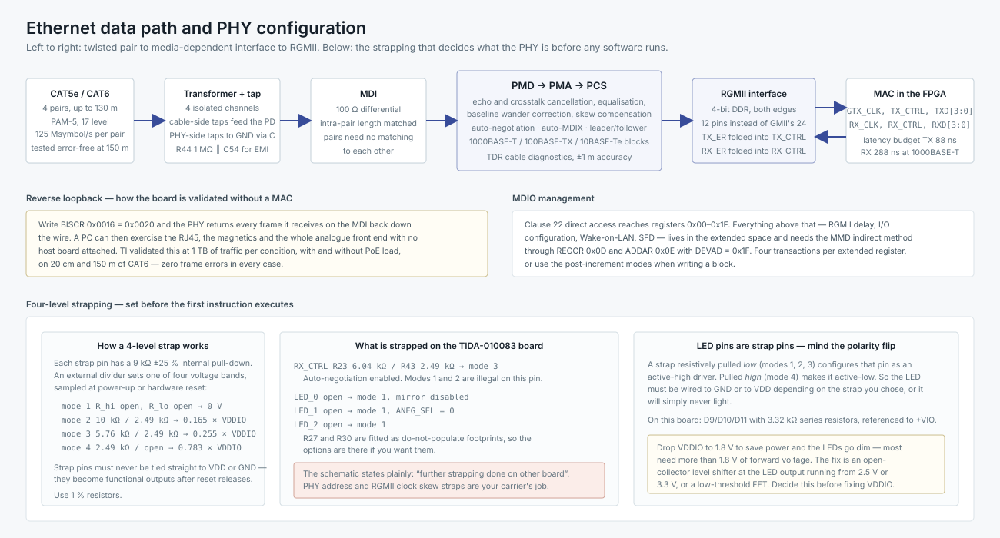
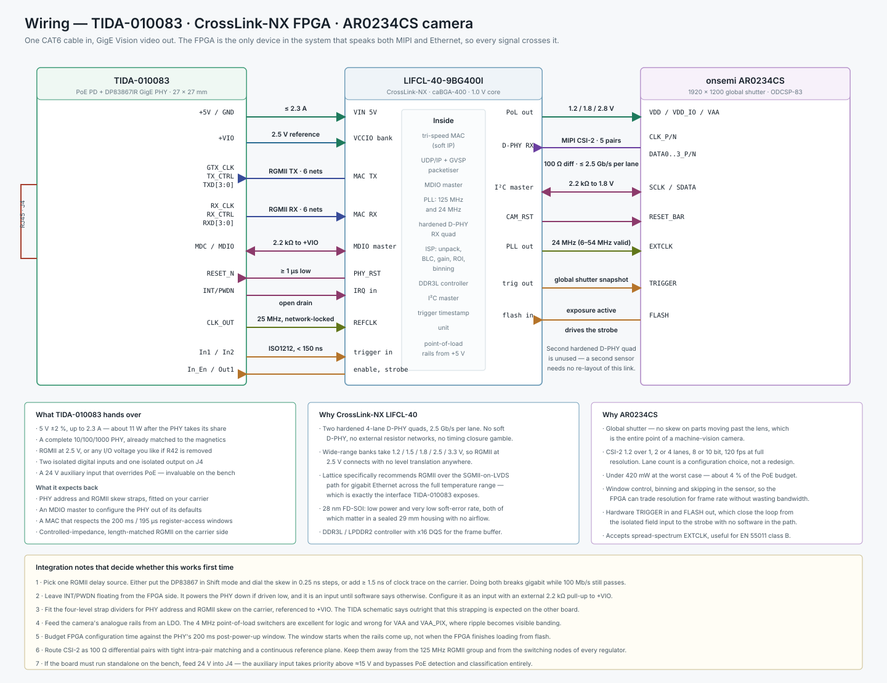
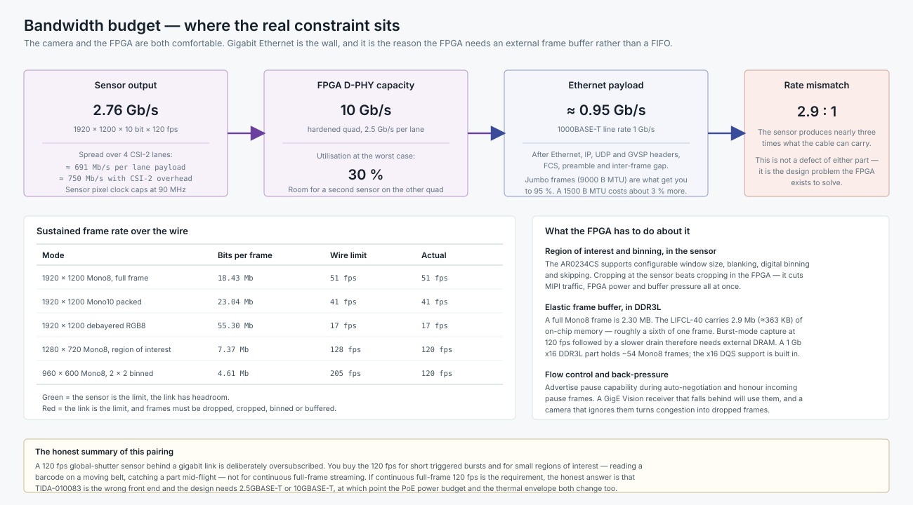

# TIDA-010083 — isolated PoE + GigE front end for machine-vision cameras

A walk-through of TI's TIDA-010083 reference design, grouped by function rather than by schematic page, followed by a larger system design that puts the board behind an FPGA and a MIPI CSI-2 image sensor.

Everything here is derived from the published TI design guide **TIDUEU3** (October 2019), the **DP83867IR/CR** datasheet (SNLS484J), the schematic **TIDM244**, and the datasheets of the selected FPGA and sensor. Where a number is an estimate rather than a datasheet figure, it says so.

---

## This design in eight parts

| Part | Where | What it covers |
|---|---|---|
| **1** | this file, §1–9 | TIDA-010083 read as a specification: function groups, power, clocks, resets, interrupts, data path |
| **2** | this file, §10–17 | The broader camera: part selection, wiring, bandwidth and power budgets |
| **3** | [`FPGA/`](FPGA/README.md) | CrossLink-NX RTL — CSI-2 receive, ISP, frame buffer, MAC, GigE Vision |
| **4** | [`PCB/`](PCB/README.md) | Floorplan, 10-layer HDI stack-up, impedance, via-in-pad, DFM, thermal, ESD and EMI |
| **5** | [`Hardware/`](Hardware/README.md) | Connector pinouts, net classes, power budget, PDN analysis, BOM |
| **6** | [`Optics/`](Optics/README.md) | Nyquist, MTF against f-number, chief-ray-angle matching, exposure and motion |
| **7** | [`Mechanical/`](Mechanical/README.md) | Focus tolerance stack, thermal interface, sealing, the housing as a Faraday cage |
| **8** | [`Verification/`](Verification/README.md) | Bring-up ladder, production test, calibration order, EMC and compliance |

Parts 1 and 2 are below. Parts 3 to 8 each carry their own diagrams and are readable on their own.

---

## Table of contents

**Part 1 — the reference design**
1. [What the board is](#1-what-the-board-is)
2. [Functional grouping](#2-functional-grouping)
3. [Power tree](#3-power-tree)
4. [Power sequencer](#4-power-sequencer)
5. [Clock tree](#5-clock-tree)
6. [Reset sequencer](#6-reset-sequencer)
7. [Interrupt architecture](#7-interrupt-architecture)
8. [Data path and PHY configuration](#8-data-path-and-phy-configuration)
9. [Design decisions worth understanding](#9-design-decisions-worth-understanding)

**Part 2 — the broader camera design**
10. [What the TIDA board demands of a host](#10-what-the-tida-board-demands-of-a-host)
11. [Part selection](#11-part-selection)
12. [How the selection satisfies the specification](#12-how-the-selection-satisfies-the-specification)
13. [Wiring](#13-wiring)
14. [Bandwidth budget](#14-bandwidth-budget)
15. [Power budget](#15-power-budget)
16. [Integration checklist](#16-integration-checklist)
17. [File manifest and references](#17-file-manifest-and-references)

---

# Part 1 — the reference design

## 1. What the board is

TIDA-010083 is a complete IEEE 802.3at Type 1 powered device with an isolated 5 V output and a gigabit Ethernet physical layer, in 27 × 27 mm. It is the front end of a machine-vision camera: one CAT6 cable carries both power and data, and the board hands a host processor or FPGA a 5 V rail and an RGMII bus.

The physical design is split across two 27 × 27 mm boards joined by a flex section so they can be folded into a 29 mm camera housing. The reference design itself is built as one rigid PCB to make it testable.

| Parameter | Specification |
|---|---|
| PoE input | 36 – 57 V, IEEE 802.3at Type 1 Class 0 |
| Maximum PoE power | 13 W at the PD input (PSE allocates 15.4 W) |
| Auxiliary input | 18 – 36 V, 24 V nominal, takes priority over PoE |
| Isolated output | 5 V, better than ±2 %, up to 2.3 A |
| Efficiency | up to 92 % |
| Isolation | **functional** (not basic or reinforced) |
| Data rate | 10 / 100 / 1000 Mbit/s |
| MAC interface | RGMII |
| Digital I/O | 2 isolated inputs, 1 isolated output |
| Size | 27 × 27 mm |

Three properties shape everything else in the design. There is **no fan and no heatsink**, so the only thermal path is 27 × 27 mm of copper. The **CMOS sensor it will sit next to degrades with temperature**, so low dissipation is a feature, not a nicety. And the **13 W budget is hard** — it is set by the standard, not by the design.



## 2. Functional grouping

The schematic reads more easily if you stop thinking in pages and start thinking in five groups.

### Group A — line interface and protection

| Part | Role |
|---|---|
| RJ45 (8P8C, shielded, 3 LEDs) | cable entry |
| T1 — Würth 749023010A | 4 × 1:1 isolated centre-tapped transformers |
| 4 × 75 Ω + capacitor | Bob Smith termination |
| R44 1 MΩ ∥ C54 1 nF / 2 kV | chassis-to-logic ground bond for EMI |
| D6, D7 — CDBHD2100-G | rectifier bridges |
| TVS3300 × 2 | surge clamping on the field I/O |
| TPD4E05U06 | ESD array on low-speed lines |

Gigabit Ethernet normally ties all four transformer centre taps together through 75 Ω resistors and a capacitor to ground. That short circuits any DC you try to inject. **Adding one capacitor per centre tap breaks the DC path** while leaving the Bob Smith termination intact for AC, and a DC voltage can then sit symmetrically across each differential pair. Up to four power lines reach the PD through two rectifier bridges, which makes the design indifferent to both polarity and which pairs the PSE chose.

### Group B — powered device and isolated conversion

| Part | Role |
|---|---|
| TPS23758RJJ | PD interface + 100 V hot-swap FET + 150 V / 0.77 Ω PWM FET + current-mode flyback controller |
| T3 — Würth 750318525 | 6 : 1 flyback transformer, 150 µH primary |
| Q1 — CSD17579Q3A | synchronous rectifier, driven by an auxiliary winding |
| LM74700-Q1 + CSD19538Q2 | ideal-diode ORing for the auxiliary input |

The TPS23758 is the reason this fits in 27 × 27 mm: it collapses the PD controller, the hot-swap switch, the PWM controller and the switching FET into one QFN. **Primary-side regulation** removes the optocoupler and the secondary shunt reference entirely — the controller senses the output through an auxiliary winding instead.

### Group C — point-of-load supplies

| Part | Setting | Output |
|---|---|---|
| TPS62801YKAR | R36 23.7 kΩ, L1 470 nH | 1.0 V → VDD1P0 |
| TPS62802YKAR | R39 44.2 kΩ, L2 470 nH | 2.5 V → VDDA2P5, and +VIO via R42 |

Both run at 4 MHz in 0.35 mm-pitch WCSP-6, which is what lets the whole supply occupy under 4 × 4 mm. The output voltage is set by a single resistor read by an on-chip resistor-to-digital converter, so one part number covers both rails.

### Group D — Ethernet PHY

DP83867IRRGZ in VQFN-48, supporting RGMII only (the QFP variant adds MII and GMII). Around it: the 25 MHz crystal, the RBIAS resistor (R1, 11.0 kΩ 1 %), the MDIO pull-up (R3, 2.2 kΩ), the four-level strap dividers, and three status LEDs with 3.32 kΩ series resistors.

### Group E — isolated digital I/O

| Part | Role |
|---|---|
| ISO1212DBQR | 2 isolated digital inputs, IEC 61131-2 Type 1/2/3 |
| R13/R22 1.00 kΩ, R14/R15 562 Ω | R_SENSE and R_THR, setting a 2.2 – 2.47 mA Type 3 current limit |
| PC3H7J00000F + R25 1 kΩ | 1 isolated digital output |
| TVS3300 U4, U5 | surge protection, field side |
| J4 — HR25-7TR-8PA(73) | 8-pin field connector |

Every channel is isolated from the others and from logic ground, and each can be wired NPN or PNP. The field side is loop-powered — unlike an optocoupler solution with discrete current limiting, the ISO1212 needs no field-side supply and has an accurate current limit, which is what keeps power dissipation and board area down.

## 3. Power tree



Two inputs, prioritised; one isolated 5 V rail; two point-of-load rails for the PHY.

**Setting the output.** Feedback is taken from the auxiliary winding, so the divider sets the *winding* voltage and the turns ratio sets the output:

```
V_aux = (200 kΩ / 36.5 kΩ + 1) × 1.75 V = 11.3 V
V_out = 11.3 V × 2.66 / 6           = 5.02 V
```

Design for a different output and you must check two things at once: that the auxiliary voltage lands in a valid range, and that the turns ratio still supports it.

**Setting the current limit.** R18 ∥ R19 = 0.91 ∥ 0.91 = 0.455 Ω, giving 0.6 V / 0.455 Ω ≈ 1.3 A peak. Two resistors in parallel, purely to spread the dissipation.

**Why the input range is the hard part.** The flyback must work from 18 V (auxiliary minimum) to 57 V (PoE maximum). At 5 V / 2.4 A out:

| Input | Peak primary current | RMS | Static FET loss |
|---|---|---|---|
| 18 V | 1.23 A | 0.86 A | 1.28 Ω × 0.86² ≈ **0.95 W** |
| 36 V | well inside limits | 0.50 A | ≈ **0.3 W** |

The datasheet allows 1.6 A peak, so 18 V is legal — but 0.95 W in a small QFN with 34.7 K/W and almost no copper to spread it is not something to design for. **Derate the output power when running from the auxiliary input.** Three transformers are characterised in the design guide: two 13 W / 5 V parts and one smaller 7 W / 4 V part, and the loop compensation differs between them (C52 6.8 nF with R28 100 kΩ for the 13 W build; C52 10 nF with R28 68 kΩ for the 7 W build).

**Why synchronous rectification.** With a diode, a primary-side-regulated flyback drifts: at light load it runs discontinuous and the diode rectifies the peak, pushing the output high; under load the diode drop pulls it down, and the drop itself moves with temperature. At 5 V or 3.3 V those errors are a large fraction of the tolerance. A synchronous FET forces continuous conduction, so the duty cycle stays constant regardless of load and the output holds ±2 % across the full range. The FET is driven straight from an extra winding, with D5 and D8 clamping V_GS; choose a part with low gate charge and accept slightly higher R_DS(on), because the losses here are dominated by turn-on and turn-off delay, not conduction.

**Why the ORing happens where it does.** The auxiliary supply is injected at V_PD, after the PD controller and before the flyback. The design guide considers three positions:

- *Before the PD controller* would force the auxiliary input above 42 V.
- *After the regulator* would need a second regulator to make 24 V usable.
- *At V_PD* — chosen — gives the widest auxiliary range with one ideal diode.

The LM74700-Q1 regulates the forward drop to 20 mV instead of a Schottky's few hundred millivolts, and the 100 V CSD19538Q2 has headroom because V_PD can sit at 57 V while V_Aux is at zero or reversed.

## 4. Power sequencer



There is no sequencer IC on this board. The order is enforced by the PSE handshake, then by the TPS23758's own hot-swap and soft-start behaviour, then by the PHY's internal power-on reset.

| Phase | V_PD | What happens |
|---|---|---|
| 1 · Detection | 2.7 – 10.1 V | PSE probes in four steps for a 19 – 26.5 kΩ signature; R20 = 24.9 kΩ presents it. Hot-swap FET open. |
| 2 · Classification | 14.5 – 20.5 V | PD sinks a constant current set by R29 = 649 Ω → 1.8 – 2.4 mA → Class 0 → 15.4 W allocated |
| 3 · Mark / ramp | rising | PSE applies full voltage |
| 4 · Inrush | 36 – 42 V window | UVLO releases (≈35.5 V rising, ≈31 V falling), hot-swap FET closes with inrush limiting |
| 5 · Converter start | 36 – 57 V | SST pin with C49 = 1 µF soft-starts the flyback |
| 6 · Rails up | — | 5 V regulates; TPS62801 and TPS62802 follow |
| 7 · PHY init | — | internal POR, straps latch, MDIO becomes usable |

The four-step detection probe exists to make the measurement robust. A current of 0 mA is a valid classification — it means Class 0, or no classification implemented, and either way the PSE allocates 15.4 W.

> **Detection resistor and Schottky leakage.** R20 is nominally 24.9 kΩ, but it may need to be increased if you swap in Schottky bridge diodes for efficiency. Schottkys leak, and the leakage adds to the signature. TI's advice is to measure the leakage across the full temperature range and confirm the signature stays inside 19 – 26.5 kΩ everywhere.

**Sequencing rules that actually bind.** The DP83867 in **two-supply mode** — 1.0 V and 2.5 V, with the 1.8 V rail generated internally — has *no supply ordering requirement*. That is precisely why the two point-of-load converters here are simply enabled from the 5 V rail with no sequencing logic. Only three-supply mode adds a rule: VDDA1P8 must be stable within 25 ms of VDDA2P5 ramping, and on power-down the 1.8 V rail must fall before the 2.5 V rail. Three-supply mode buys 495 mW → 457 mW. This board declines the trade.

An auxiliary input above roughly 15 V short-circuits phases 1 through 4 entirely, which is what makes bench work practical.

## 5. Clock tree



One 25 MHz reference feeds the entire data side. The receive clock is *recovered from the line*, not generated locally — the two domains meet inside the PHY's elastic buffering.

| Clock | Frequency | Source | Notes |
|---|---|---|---|
| XI / XO | 25 MHz ±50 ppm | crystal (populated) | external oscillator alternative: remove crystal, fit C62 |
| Local reference | 25 MHz | XI | central source for all device clocking; embedded into transmitted traffic |
| TX symbol clock | 125 Msymbol/s | reference × PLL | PAM-5, 17 level, 4 pairs |
| RX_CLK | 125 / 25 / 2.5 MHz | recovered from line | locked to the link partner's transmit clock |
| GTX_CLK | 125 MHz | the MAC (FPGA) | continuous; held low until the MAC confirms speed match |
| CLK_OUT | 25 or 125 MHz | I/O Config 0x0170 | unused on this board |
| MDC | ≤ 25 MHz | the MAC | asynchronous, gapped, no minimum |
| JTAG_CLK | ≤ 2.5 MHz | debugger | asynchronous |
| TPS62801/2 PWM | 4 MHz | internal | 1.5 MHz in the alternate mode |
| Flyback PWM | set by FRS (R41 60.4 kΩ) | internal | dithered by DTHR (R38 237 kΩ) for EMI |

Speed scaling on the RGMII clocks: 125 MHz at 1000 Mb/s (T_cyc 8 ns, duty 45 – 55 %), 25 MHz at 100 Mb/s, 2.5 MHz at 10 Mb/s (duty 40 – 60 %). RX_CLK stretches a pulse when crossing from the free-running clock to the packet clock and never glitches.

> **The external-clock trap.** XI is a 1.8 V-domain input. It wants 1.5 – 1.9 V peak-to-peak and its absolute maximum is 2.1 V. A 2.5 V or 3.3 V oscillator connected directly will exceed it. AC-couple and attenuate, and leave XO floating.

**RGMII source-synchronous timing — the one thing to get right.** RGMII is source-synchronous and double-data-rate. At 125 MHz each half cycle is 4 ns, so the receiver needs the clock shifted roughly a quarter cycle away from the data edges. There are exactly two legal ways to produce that shift and you must pick **one per direction**:

- **Board delay** — leave the PHY in Aligned mode and route the clock trace ≥ 1.5 ns longer than the data. Costs layout area.
- **Internal delay** — put the PHY in Shift mode and dial 0 – 3.5 ns in 0.25 ns steps via RGMIICTL (0x0032) and RGMIIDCTL (0x0086), or by strap. Preferred: no extra trace length, tunable after the board exists.

Do both and you double-shift the clock. The link then fails at gigabit while continuing to pass traffic at 100 Mb/s — the classic RGMII symptom, and a genuinely confusing one to debug. Budget figures: T_skewT −500 to +500 ps at the transmitter, T_skewR 1.0 – 2.6 ns at the receiver, 1.0 – 2.0 ns internal setup and hold when the PHY's own delay is used.

> **The most useful pin nobody uses.** CLK_OUT is unconnected on this board, but through register 0x0170 it can emit the recovered receive clock divided by five — a network-locked 25 MHz. Feed that to a host FPGA and you delete an oscillator from the bill of materials and get synchronous Ethernet at the same time. Part 2 takes this option.

## 6. Reset sequencer



The DP83867 includes an internal power-on reset and **does not need to be explicitly reset for normal operation**. What it does need is for the host to respect two very different waiting periods.

### Cold power-up

| Symbol | Value | Meaning |
|---|---|---|
| T1 | ≥ 200 ms | stabilisation before the first MDC preamble |
| T2 | ≤ 200 ms | hardware configuration latch-in from power-up |
| T3 | 64 ns | dual-function pins hand over to their output drivers |

### Hardware reset

| Symbol | Value | Meaning |
|---|---|---|
| T4 | ≥ 1 µs | RESET_N pulse width, with XI stable throughout |
| T2 | 120 ns | strap re-latch after deassertion |
| T3 | 64 ns | pins become outputs |
| T1 | ≥ 195 µs | stabilisation before the first MDC preamble |

Note the asymmetry: **200 ms after power-up, 195 µs after a hardware reset** — three orders of magnitude apart, and both easy to violate in a fast FPGA boot. MDC may toggle during T1 provided MDIO is held high. The management entity must not start a transaction in the first cycle after power-up reset; the bus must stay idle for at least one MDC cycle after hard reset deasserts.

### The four reset mechanisms

| Mechanism | Trigger | Registers affected | Straps |
|---|---|---|---|
| Power-on reset | automatic | all → defaults | sampled fresh |
| Hardware reset | RESET_N low ≥ 1 µs | all → defaults | re-sampled from pins |
| IEEE software reset | BMCR 0x0000 bit 15 | IEEE standard registers only | re-applied from last sample |
| Global software reset | CTRL 0x001F bit 15 | all internal circuits, IEEE + extended | hardware config maintained |
| Global software restart | CTRL 0x001F bit 14 | everything *except* the register file | untouched — settings survive |

The **restart** is the one to reach for after writing configuration that only takes effect on link re-establishment. For instance, IEEE 1588 start-of-frame determinism requires loading Sync FIFO Control (0x00E9) with 0xDF22 *before* a link comes up; if a link is already present, set the register and then issue a restart. It re-initialises the datapath without discarding what you just wrote.

## 7. Interrupt architecture



One shared open-drain line carries every PHY event, letting the MAC act on PHY state without polling.

**Sources** — link status change, auto-negotiation complete, auto-negotiation error, speed change, duplex change, false carrier, jabber, page received, MDI crossover change, energy detect, fast link drop, and Wake-on-LAN magic-packet or pattern match.

**Registers** — MICR (0x0012) holds the per-source enable mask; ISR (0x0013) holds the latched status and is **clear-on-read**.

**Pin** — INT/PWDN, pin 44 on the VQFN-48. When configured as an interrupt it is open-drain and active low, and TI recommends an external 2.2 kΩ pull-up to VDDIO.

> **The default function is POWER DOWN, not interrupt.** The pin is an input with an internal pull-up until software says otherwise. An FPGA that drives it low during configuration will quietly put the PHY into power-down, and the symptom — a PHY that answers MDIO but never links — looks nothing like the cause. Configure the FPGA pin as an input only, and rely on the external pull-up.

Bring-up order:

1. Wait out T1 after reset. Until then the PHY will not answer MDIO at all.
2. Switch the pin's function from power-down to interrupt, then program MICR with the sources you care about. Link status change alone covers most applications.
3. Read ISR once to clear anything latched during bring-up, then enable the FPGA's edge detector. Skipping this leaves a stale assertion that looks exactly like a dead interrupt line.
4. On an event, the ISR bit latches and the pin pulls the shared line low. It stays low however many events pile up behind it.
5. Read ISR. Clear-on-read means one read consumes every pending bit, so decode the whole word — do not test one bit and discard the rest.
6. Confirm the line has returned high before re-arming. If it has not, a new event arrived during the read; loop back to step 5 rather than waiting for another edge.

Two further traps: Wake-on-LAN interrupts are suppressed while BMCR bit 10 (ISOLATE) is set, because that disables the MAC interface; and the pull-up must go to the same VDDIO the PHY runs on, since tying it to 3.3 V while VDDIO is 2.5 V forward-biases the pin protection.

**The other asynchronous path.** The two ISO1212 channels do not pass through the PHY at all. Their outputs go straight to host GPIO and are the natural hardware-trigger source for a camera. The isolator passes a 150 ns minimum pulse and runs to 4 Mb/s, so trigger jitter comes from host sampling rather than from the isolation. The digital *output* is a plain optocoupler and is orders of magnitude slower — use it for busy or ready flags, not for anything you intend to time precisely.

**Polling fallback.** BMSR (0x0001) bit 2 reports link status directly and latches low, so a slow poll is legitimate if the interrupt pin is not routed. Auto-negotiation takes 2 – 3 seconds to complete, so polling faster than roughly 100 ms buys nothing.

## 8. Data path and PHY configuration



Twisted pair → transformer → MDI → PCS/PMA/PMD → RGMII → MAC. The MDI must be routed as 100 Ω differential pairs with intra-pair length matching; the four pairs are independent of each other and need no matching between them.

**Four-level strapping.** Each strap pin carries a 9 kΩ ±25 % internal pull-down, and an external divider selects one of four voltage bands sampled at power-up or hardware reset:

| Mode | R_hi | R_lo | Target |
|---|---|---|---|
| 1 | open | open | 0 V |
| 2 | 10 kΩ | 2.49 kΩ | 0.165 × VDDIO |
| 3 | 5.76 kΩ | 2.49 kΩ | 0.255 × VDDIO |
| 4 | 2.49 kΩ | open | 0.783 × VDDIO |

Strap pins must **never** be tied directly to VDD or GND, because they become functional outputs the moment reset releases. Use 1 % resistors.

What the TIDA board actually straps: RX_CTRL with R23 6.04 kΩ / R43 2.49 kΩ → mode 3 → auto-negotiation enabled (modes 1 and 2 are illegal on this pin). LED_0, LED_1 and LED_2 are left open → mode 1. R27 and R30 are fitted as do-not-populate footprints.

> The schematic states it plainly: **"Further strapping done on other board."** PHY address (via RX_D0 and RX_D2) and RGMII clock skew (via LED_1 and LED_2) are your carrier board's responsibility. The VQFN-48 part supports 16 PHY addresses using a 4-bit address; the QFP part supports 32 with 5 bits. Default strap configuration puts the PHY at address 0x00.

**LED pins are strap pins, and the polarity flips.** A strap resistively pulled *low* (modes 1, 2, 3) configures that pin as an active-high driver; pulled *high* (mode 4) makes it active-low. So the LED must be wired to GND or to VDD depending on the strap you chose, or it simply never lights. And at 1.8 V VDDIO the LEDs go dim, because most LEDs need more forward voltage than that — the fix is an open-collector level shifter at the LED output running from 2.5 V or 3.3 V.

**Validation without a MAC.** Writing BISCR (0x0016) to 0x0020 puts the PHY in reverse loopback, returning every frame received on the MDI straight back down the wire. TI validated the board this way with at least 1 TB of traffic per condition, on 20 cm and 150 m of CAT6, with and without PoE load at 7 W and 13 W — zero frame errors in every case.

**MDIO extended access.** Clause 22 direct access reaches registers 0x00 – 0x1F. Everything above that — RGMII delay, I/O configuration, Wake-on-LAN, SFD — lives in the extended space and requires the MMD indirect method through REGCR (0x0D) and ADDAR (0x0E) with DEVAD = 0x1F. That is four transactions per extended register, or fewer using the post-increment modes when writing a block.

## 9. Design decisions worth understanding

**Why the board is split in two.** The RJ45 connector and the data transformer alone consume most of a 27 × 27 mm footprint. Splitting connectors and magnetics onto one board and everything else onto a second, joined by flex and folded, is what makes 27 × 27 mm achievable at all.

**Where the heat goes.** On the auxiliary input at 18 V, the hot spots are the TPS23758 and its current-sense resistors — most of the dissipation is the flyback switch FET. On PoE, the rectifier bridges become a second significant source. The secondary-side rectification FET and the ORing FET barely warm. If you need more total power, the options are active rectification in place of the bridges, more copper area, or thicker copper.

**Test-point resistors.** R10 (0 Ω) isolates the 1.0 V converter's input so efficiency can be measured and bring-up staged. R42 (0 Ω) bridges the 2.5 V rail to +VIO; remove it to drive the I/O voltage externally at 1.8 V or 3.3 V. Both are deliberate, and both are decisions you inherit.

**Functional isolation, not safety isolation.** The specification table says *functional*. It is crossed three separate times — by the Ethernet transformer, by the flyback transformer, and by the ISO1212 and optocoupler. The ISO1212 itself carries UL 1577 recognition at 2500 V_RMS, but that does not make the board as a whole a safety barrier.

---

# Part 2 — the broader camera design

## 10. What the TIDA board demands of a host

Reading the design guide as a specification for the *other* board:

| Requirement | Detail |
|---|---|
| Accept 5 V at up to 2.3 A | roughly 11 W usable after the PHY subsystem |
| Drive RGMII | 12 signals, controlled impedance, length matched |
| Match the I/O voltage | 2.5 V as shipped, or supply +VIO externally with R42 removed |
| Provide an MDIO master | the PHY must be configured out of its defaults |
| Fit the missing straps | PHY address and RGMII clock skew, on the carrier |
| Respect the reset windows | 200 ms after power-up, 195 µs after hardware reset |
| Leave INT/PWDN alone | input only, external pull-up |
| Optionally consume CLK_OUT | 25 MHz network-locked reference |
| Handle the isolated I/O | 2 inputs, 1 output, 1 enable |

Plus the implicit ones: it must fit a 29 mm housing, it must not need a fan, and it must not heat the image sensor.

## 11. Part selection

### FPGA — Lattice CrossLink-NX **LIFCL-40-9BG400I**

| Attribute | Value |
|---|---|
| Logic | 39 K logic cells, 56 × 18 × 18 multipliers |
| Memory | 2.9 Mb embedded (EBR + LRAM) |
| MIPI | **2 hardened 4-lane D-PHY**, 2.5 Gb/s per lane, 10 Gb/s per quad, 20 Gb/s aggregate |
| I/O | 192 sysI/O; wide-range banks 1.2 / 1.5 / 1.8 / 2.5 / 3.3 V, HP banks to 1.8 V |
| Memory interface | DDR3 / DDR3L / LPDDR2 with DQS, ×16, to 1066 Mb/s |
| Core | 1.0 V, 28 nm FD-SOI |
| Package | caBGA-400, 17 × 17 mm |

*Confirm the exact speed-grade / temperature / package combination with Lattice before committing; the public evaluation platform is the commercial LIFCL-40-9BG400C. LIFCL-17 is the cost-reduced option if the pipeline fits in 17 K logic cells, and smaller packages exist if 17 × 17 mm is too large for your housing.*

### Image sensor — onsemi **AR0234CS**

| Attribute | Value |
|---|---|
| Format | 1/2.6 inch, 1920 × 1200 = 2.3 MP, 3.0 µm pixel |
| Shutter | **global** |
| Output | MIPI CSI-2 1.2 / D-PHY 1.2, 1, 2 or 4 lanes, 8 or 10 bit (parallel also available) |
| Frame rate | 120 fps at full resolution over MIPI (30 fps over parallel) |
| Input clock | 6 – 54 MHz; maximum output pixel clock 90 MHz |
| Supplies | 1.2 V digital, 1.8 or 2.8 V I/O, 2.8 V analogue; VAA_PHY 2.8 V, VDDIO_PHY 1.8 V only |
| Power | < 420 mW; < 395 mW at 120 fps full resolution per the later revision |
| Features | window control, digital binning and skipping, mirror, hardware trigger, flash output |

Monochrome and colour variants exist with 0° or 28° chief-ray-angle options; monochrome is usually the right choice for inspection.

### Supporting parts

| Part | Role |
|---|---|
| DDR3L SDRAM, 1 Gb ×16 | elastic frame buffer — see §14 for why this is mandatory |
| SPI NOR flash, 128 Mb | FPGA configuration |
| TPS62802 ×3 | 1.0 V core, 1.8 V VCCAUX/IO, 1.35 V DDR3L |
| TPS62801 | 1.2 V camera digital + HP bank |
| TPS7A20 LDO | 2.8 V camera analogue — low noise, deliberately not a switcher |

## 12. How the selection satisfies the specification

| TIDA-010083 requirement | How the selection meets it |
|---|---|
| **RGMII at 2.5 V** | CrossLink-NX wide-range banks accept 2.5 V V_CCIO directly. **No level translation anywhere in the link** — which matters in a 27 × 27 mm envelope where a translator array would not fit, and matters for timing because every translator adds skew to a source-synchronous bus with a 4 ns half cycle. |
| **RGMII rather than SGMII** | Lattice's own datasheet notes that SGMII over LVDS I/O has limitations across the full temperature range and recommends SERDES or RGMII for gigabit Ethernet designs. RGMII is exactly what TIDA-010083 exposes, so the recommended path and the available interface coincide. |
| **MDIO master + strap responsibility** | Soft MDIO master in fabric; the four-level dividers for PHY address and RGMII skew sit on the carrier, referenced to +VIO, as the TIDA schematic explicitly expects. |
| **Reset and interrupt discipline** | FPGA drives RESET_N push-pull; INT/PWDN is configured as an input with a 2.2 kΩ pull-up to +VIO and is never driven. The configuration state machine waits out the 200 ms window measured from rail-up, not from configuration-done. |
| **Clock** | The PHY's CLK_OUT, set to the ÷5 recovered clock via register 0x0170, becomes the board reference. A CrossLink-NX PLL derives 125 MHz for GTX_CLK and 24 MHz for the sensor's EXTCLK. This removes an oscillator and makes the sensor's frame timing traceable to the network clock — useful for IEEE 1588 and for multi-camera synchronisation. |
| **≤ 11 W power budget** | Estimated total around 3 W (§15). The sensor alone is under 420 mW, about 4 % of the budget. |
| **No fan, sensor heat sensitivity** | 28 nm FD-SOI is low power for the logic density, and FD-SOI's very low soft-error rate is a genuine benefit in a sealed industrial device that may run for years without a reboot. |
| **MIPI ingest** | The hardened D-PHY quad accepts the sensor's 4 lanes with no soft D-PHY, no external resistor networks, and no timing-closure gamble. At the sensor's worst case it runs at 30 % utilisation, and the **second quad is entirely free** — a second sensor for stereo or multispectral work needs no re-layout of the Ethernet side. |
| **Isolated trigger path** | ISO1212 outputs land on FPGA GPIO, are timestamped against the network clock, and drive the sensor's hardware TRIGGER pin. The sensor's FLASH output drives the strobe. No software in the latency path. |
| **Frame buffering** | DDR3L / LPDDR2 controller with ×16 DQS support is built into the device. |

## 13. Wiring



### TIDA-010083 ↔ FPGA

| Signal | Width | Direction | Notes |
|---|---|---|---|
| +5 V, GND | — | TIDA → FPGA | up to 2.3 A; use many ground pins |
| +VIO | 1 | TIDA → FPGA | 2.5 V; sets the RGMII bank's V_CCIO |
| GTX_CLK, TX_CTRL, TXD[3:0] | 6 | FPGA → TIDA | 125 MHz DDR |
| RX_CLK, RX_CTRL, RXD[3:0] | 6 | TIDA → FPGA | 125 MHz DDR |
| MDC | 1 | FPGA → TIDA | ≤ 25 MHz |
| MDIO | 1 | bidirectional | 2.2 kΩ pull-up to +VIO |
| RESET_N | 1 | FPGA → TIDA | ≥ 1 µs low |
| INT/PWDN | 1 | TIDA → FPGA | open drain, 2.2 kΩ to +VIO, **never driven** |
| CLK_OUT | 1 | TIDA → FPGA | 25 MHz, network-locked |
| In1, In2 | 2 | TIDA → FPGA | ISO1212 outputs, trigger in |
| In_En | 1 | FPGA → TIDA | ISO1212 enable |
| Out1 | 1 | FPGA → TIDA | optocoupler drive, strobe out |

### FPGA ↔ AR0234CS

| Signal | Width | Direction | Notes |
|---|---|---|---|
| CLK_P/N, DATA0–3_P/N | 5 pairs | camera → FPGA | 100 Ω differential, to a hardened D-PHY quad |
| SCLK, SDATA | 2 | bidirectional | two-wire serial at 1.8 V, 2.2 kΩ pull-ups |
| RESET_BAR | 1 | FPGA → camera | active low |
| EXTCLK | 1 | FPGA → camera | 24 MHz |
| TRIGGER | 1 | FPGA → camera | global shutter snapshot |
| FLASH | 1 | camera → FPGA | exposure active; drives the strobe |
| VDD 1.2 V, VDD_IO 1.8 V, VAA / VAA_PIX 2.8 V | — | FPGA carrier → camera | analogue rails from an LDO |

### End-to-end trigger chain

A sensor on the line closes a contact on J4 → the ISO1212 passes the edge across the isolation barrier in under 150 ns → an FPGA input captures and timestamps it against the network clock → TRIGGER fires the global shutter → FLASH goes high for the exposure duration and drives the strobe → the frame carries the trigger timestamp before it is packetised. Every element is deterministic except the optocoupler on Out1, which is exactly why the strobe is driven from the sensor's FLASH pin rather than from the isolated output.

## 14. Bandwidth budget



This is the most important analysis in the system, and it is the reason the design needs external DRAM rather than a FIFO.

```
Sensor:   1920 × 1200 × 10 bit × 120 fps  = 2.76 Gb/s
Per lane: 2.76 Gb/s / 4                   ≈ 691 Mb/s  (≈750 Mb/s with CSI-2 overhead)
D-PHY:    4 × 2.5 Gb/s                    = 10 Gb/s     → 30 % utilised
Ethernet: 1 Gb/s line rate                ≈ 0.95 Gb/s payload with jumbo frames
```

**The camera and the FPGA are both comfortable. Gigabit Ethernet is the wall.** The mismatch is roughly 2.9 : 1.

| Mode | Bits per frame | Wire limit | Achievable |
|---|---|---|---|
| 1920 × 1200 Mono8 | 18.43 Mb | 51 fps | 51 fps *(link-limited)* |
| 1920 × 1200 Mono10 packed | 23.04 Mb | 41 fps | 41 fps *(link-limited)* |
| 1920 × 1200 debayered RGB8 | 55.30 Mb | 17 fps | 17 fps *(link-limited)* |
| 1280 × 720 Mono8 ROI | 7.37 Mb | 128 fps | 120 fps *(sensor-limited)* |
| 960 × 600 Mono8, 2 × 2 binned | 4.61 Mb | 205 fps | 120 fps *(sensor-limited)* |

Three consequences for the FPGA design:

1. **Crop and bin in the sensor, not the FPGA.** The AR0234CS supports configurable window size, blanking, digital binning and skipping. Doing it at the source cuts MIPI traffic, FPGA switching power and buffer pressure simultaneously.
2. **The frame buffer must be external.** One Mono8 frame is 2.30 MB. The LIFCL-40 carries 2.9 Mb (≈363 KB) on chip — roughly a sixth of one frame. Burst capture at 120 fps followed by a slower drain therefore needs DRAM. A 1 Gb ×16 DDR3L part holds about 54 Mono8 frames.
3. **Implement flow control.** Advertise pause capability during auto-negotiation and honour incoming pause frames. A receiver that falls behind will use them, and a camera that ignores them turns congestion into dropped frames.

**The honest summary.** A 120 fps global-shutter sensor behind a gigabit link is deliberately oversubscribed. You buy the 120 fps for short triggered bursts and small regions of interest — reading a barcode on a moving belt, catching a part mid-flight — not for continuous full-frame streaming. If continuous full-frame 120 fps is a hard requirement, TIDA-010083 is the wrong front end and the design needs 2.5GBASE-T or 10GBASE-T, at which point the PoE class, the power budget and the thermal envelope all change too.

## 15. Power budget

| Item | Estimate | Basis |
|---|---|---|
| PSE allocation | 15.4 W | Class 0 |
| PD input budget | 12.95 W | IEEE 802.3at Type 1 |
| Flyback output at ≈90 % | ≈ 11.6 W | 5 V × 2.3 A |
| less DP83867 + PoL losses | −0.55 W | 495 mW two-supply + converter loss |
| **Available to the carrier** | **≈ 11.0 W** | ≈ 2.2 A at 5 V |

Against that:

| Load | Estimate | Confidence |
|---|---|---|
| AR0234CS sensor | 0.42 W | datasheet |
| Camera rails incl. LDO loss | ≈ 0.55 W from 5 V | calculated |
| LIFCL-40 (MIPI RX + ISP + MAC + DDR PHY) | ≈ 1.0 – 1.5 W | **estimate — run the Lattice Power Calculator** |
| DDR3L 1 Gb ×16 | ≈ 0.4 W | typical |
| Flash, LEDs, miscellaneous | ≈ 0.1 W | typical |
| **Total** | **≈ 2.5 – 3.0 W** | leaves ≈ 8 W headroom |

That headroom is not spare — it is what pays for integrated illumination, which in a real barcode reader or inspection camera is often the largest single consumer. Budget it deliberately rather than discovering it.

Two derating notes. On the auxiliary input at 18 V the flyback runs at its worst case and the output power must be reduced. And the 13 W ceiling is the *PD input*, so anything you add on the carrier comes out of the same allocation.

## 16. Integration checklist

1. **Pick one RGMII delay source.** PHY Shift mode *or* ≥ 1.5 ns of extra clock trace — never both. Doing both breaks gigabit while 100 Mb/s keeps working.
2. **Leave INT/PWDN floating from the FPGA side.** It is a power-down input until software changes it. Configure the FPGA pin as an input with an external 2.2 kΩ pull-up to +VIO.
3. **Fit the four-level strap dividers on the carrier** for PHY address and RGMII skew, referenced to +VIO, with 1 % resistors. Never tie a strap pin hard to a rail.
4. **Feed the camera's analogue rails from an LDO.** The 4 MHz point-of-load switchers are excellent for logic and wrong for VAA and VAA_PIX, where ripple becomes visible banding.
5. **Budget FPGA configuration time against the PHY's 200 ms window.** The window starts when the rails come up, not when the FPGA finishes loading from flash.
6. **Route CSI-2 as 100 Ω differential pairs** with tight intra-pair matching and a continuous reference plane, away from the 125 MHz RGMII group and from every regulator's switching node.
7. **Decide the I/O voltage early.** 1.8 V saves power but dims the PHY's status LEDs and needs a level shifter to drive them.
8. **Use the auxiliary input on the bench.** 24 V into J4 takes priority above ≈15 V and bypasses PoE detection and classification entirely.
9. **Bring up the data path with reverse loopback** (BISCR 0x0016 = 0x0020) before the MAC exists. It exercises the RJ45, magnetics and analogue front end with nothing but a PC at the other end of the cable.
10. **Verify the detection signature over temperature** if you change the rectifier diodes, particularly to Schottkys.

## 17. File manifest and references

### Diagrams

| File | Contents |
|---|---|
| `diagrams/01-system-block-diagram.svg` | three signal bands, five functional groups, three isolation barriers |
| `diagrams/02-power-tree.svg` | inputs → ORing → flyback → 5 V → point-of-load rails, with setting resistors |
| `diagrams/03-power-sequencer.svg` | seven-phase PoE bring-up and rail ordering |
| `diagrams/04-clock-tree.svg` | reference, recovered, RGMII, management and converter clock domains |
| `diagrams/05-reset-sequencer.svg` | power-up and hardware-reset timing, four reset mechanisms |
| `diagrams/06-interrupt-diagram.svg` | event sources, MICR/ISR, open-drain pin, host handshake |
| `diagrams/07-datapath-and-straps.svg` | MDI → RGMII chain, four-level strapping, LED polarity |
| `diagrams/08-system-wiring.svg` | **TIDA-010083 ↔ FPGA ↔ camera wiring** |
| `diagrams/09-bandwidth-budget.svg` | sensor-to-wire rate analysis and mitigations |

### Source documents

| Document | Identifier |
|---|---|
| TIDA-010083 design guide | TIDUEU3, October 2019 |
| TIDA-010083 schematic | TIDM244 |
| TIDA-010083 bill of materials | TIDM245 |
| DP83867IR/CR datasheet | SNLS484J |
| TPS23758 datasheet | IEEE 802.3at PoE PD with no-opto sync flyback controller |
| LM74700-Q1, ISO1212, TVS3300, TPS6280x | respective TI product folders |
| Analog Design Journal article | SLYT784, September 2019 |
| CrossLink-NX family datasheet | Lattice FPGA-DS-02049 |
| AR0234CS datasheet | onsemi AR0234CS/D |

### Caveats

- Component designators, values and strap configurations are transcribed from the published design guide and schematic extracts. Verify against the current revision of TIDM244 before committing a layout.
- The FPGA part number, package and temperature grade in Part 2 are a proposal, not a validated selection. Confirm availability and run the vendor power estimator.
- Register addresses and timing figures are from the datasheet revisions cited above and may change; check the current revision.
- Isolation on TIDA-010083 is **functional**. Do not treat this design as a safety barrier without a separate qualification.
