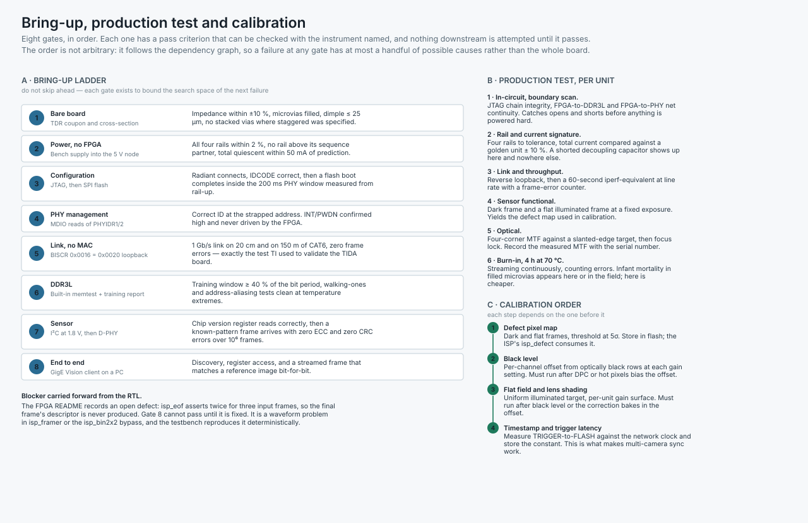

# Bring-up, test, calibration and compliance

**Part 8 of the TIDA-010083 review.** Everything up to here is design. This part is what you do when the boards arrive, what you do to every unit after that, and what you have to prove before you can sell one.

The organising idea is that each stage has a **pass criterion that can be checked with a named instrument**, and nothing downstream is attempted until it passes. That is not process ceremony — it is what keeps a failure at gate 6 from having forty possible causes.

---

## 1. Bring-up ladder

| # | Gate | Instrument | Pass criterion |
|---|---|---|---|
| 1 | Bare board | TDR coupon, cross-section | Impedance within ± 10 % of every target in `net-classes.csv`; microvias filled, dimple ≤ 25 µm; staggered where Part 4 §5.3 specified staggered |
| 2 | Power, no FPGA | Bench supply into the 5 V node | All five rails within 2 %; no rail up before its sequence partner; total quiescent within 50 mA of the prediction in `power-budget.csv` |
| 3 | Configuration | JTAG, then SPI flash | Radiant connects, IDCODE correct. Then a flash boot completes **inside the 200 ms PHY window measured from rail-up**, not from configuration-done |
| 4 | PHY management | MDIO reads of PHYIDR1/2 | Correct ID at the strapped address. INT/PWDN confirmed high and never driven by the FPGA |
| 5 | Link, no MAC | BISCR `0x0016` = `0x0020` | 1 Gb/s link on 20 cm and on 150 m of CAT6, zero frame errors — the same reverse-loopback test TI used to validate the TIDA board |
| 6 | DDR3L | Built-in memtest, training report | Read-training window ≥ 40 % of the bit period; walking-ones and address-aliasing clean at both temperature extremes |
| 7 | Sensor | I²C at 1.8 V, then D-PHY | Chip version register correct; then a known-pattern frame with zero ECC and zero CRC errors over 10⁶ frames |
| 8 | End to end | GigE Vision client | Discovery, register access, and a streamed frame matching a reference image bit-for-bit |

### Why this order

Gates 3 to 5 come before DDR3L because they need almost nothing: the FPGA, one bank at 2.5 V, and a PC. Gate 5 in particular is worth a lot — reverse loopback exercises the RJ45, the magnetics and the entire analogue front end **before any MAC exists**, so a link failure at that point is unambiguously an analogue or magnetics problem.

Gate 6 before gate 7 because the sensor produces 2.76 Gb/s into a frame buffer, and debugging a MIPI receiver while the buffer underneath it is unreliable is a waste of a week.

### Two things to instrument in the RTL before the boards arrive

**The DDR3L training margin must be readable over the production interface.** Part 4 §2.5 explains why: every DDR3L net is a stripline between two ground planes with no via to the surface. That is the right SI decision and it means there is no probe point. The controller's own read-training result is the only visibility you get, so expose it in the register map.

**A rail and current signature needs a golden reference.** Gate 2 compares against a prediction; production compares against a golden unit. Record the golden unit's numbers during bring-up while you still know the board is good.

### Blocker carried forward from the RTL

The FPGA README records an open defect: **`isp_eof` asserts twice for three input frames**, so the final frame's descriptor is never produced and that frame never streams. The pixel data reaches DDR correctly — the loss is the frame boundary. Gate 8 cannot pass until it is fixed. It is narrowed to `isp_framer` or the `isp_bin2x2` bypass path in `isp.v`, and the testbench reproduces it deterministically, so it should be fixed with a waveform rather than a guess.

Three further RTL items gate a shippable unit rather than a working board, and are listed honestly in the FPGA README: `sensor_init` is a skeleton pending onsemi's full power-up sequence, the CSI-2 ECC table is the commonly published set rather than the normative one, and the GenICam XML description file does not exist.

---

## 2. Production test, per unit

| # | Step | What it catches |
|---|---|---|
| 1 | In-circuit, JTAG boundary scan | Opens and shorts on FPGA-to-DDR3L and FPGA-to-PHY nets, before anything is powered hard |
| 2 | Rail and current signature | A shorted decoupling capacitor. Compare total current against the golden unit ± 10 % |
| 3 | Link and throughput | Reverse loopback, then 60 s at line rate with a frame-error counter |
| 4 | Sensor functional | Dark frame and flat illuminated frame at fixed exposure — also produces the defect map for calibration |
| 5 | Optical | Four-corner MTF against a slanted-edge target, then focus lock. Record the measured MTF with the serial number |
| 6 | Burn-in, 4 h at 70 °C | Infant mortality in filled microvias. It appears here or in the field; here is two orders of magnitude cheaper |

Part 4 §6.4 explains why there are no test points: there is no room on 27 × 27 mm, and boundary scan covers most nets because most nets terminate on an FPGA ball. Steps 1 and 2 together give the coverage a bed of nails would have, for the cost of a Tag-Connect footprint.

**Step 5 is the step most likely to be dropped and most likely to be needed.** Part 7 §1 shows focus cannot be held by tolerance. If the line does not measure MTF and lock focus per unit, the camera ships out of focus and the failure looks like a lens problem for the entire production run.

---

## 3. Calibration order

Each step depends on the one before it. Running them out of order does not merely waste time — it bakes the earlier error into the later correction.

1. **Defect pixel map.** Dark and flat frames, threshold at 5σ. Stored in flash; `isp_defect` consumes it.
2. **Black level.** Per-channel offset from the optically black rows, at each gain setting. *Must run after* defect mapping, or hot pixels bias the offset.
3. **Flat field and lens shading.** Uniform illuminated target, per-unit gain surface. *Must run after* black level, or the correction bakes in the offset it was supposed to remove.
4. **Timestamp and trigger latency.** Measure TRIGGER-to-FLASH against the network clock and store the constant. This is what makes multi-camera synchronisation work, and it is the payoff for the network-locked clock in Part 2 §12.

Note what calibration does **not** fix: Part 6 §4 shows that flat-field correction of a chief-ray-angle mismatch recovers brightness and destroys signal-to-noise. Calibration corrects manufacturing spread. It does not correct a design error.

---

## 4. Compliance

### EMC

Pre-compliance plan is in Part 4 §8.6. The formal set for an industrial camera sold in Europe:

| Standard | Test | Note |
|---|---|---|
| CISPR 32 / EN 55032 | Radiated and conducted emissions, 30 MHz – 6 GHz | **Decide Class A or Class B early** — the margin difference is 10 dB and it changes the design, not just the paperwork |
| IEC 61000-4-2 | ESD, ± 8 kV contact / ± 15 kV air | 10 discharges per point: lens face, RJ45 shell, every screw head, every seam |
| IEC 61000-4-3 | Radiated immunity, 10 V/m, 80 MHz – 6 GHz | Pass criterion defined **before** booking: no dropped frames, no I²C lockup, no link renegotiation |
| IEC 61000-4-4 | EFT, ± 1 kV on the Ethernet cable | |
| IEC 61000-4-5 | Surge, ± 1 kV line to earth | TVS3300 on the field I/O already covers its half |
| IEC 61000-4-6 | Conducted immunity, 10 V, 150 kHz – 80 MHz | |
| EN 61326-1 | The umbrella standard that points at the above | |

### Safety and environmental

| Area | Status |
|---|---|
| Isolation | **Functional, not safety.** Part 1 §9 is explicit. The ISO1212 carries UL 1577 recognition at 2500 VRMS, but the board as a whole is not a safety barrier and must not be sold as one |
| PoE | IEEE 802.3at Type 1, Class 0. Interoperability testing against multiple PSE vendors is a real exercise, not a formality |
| Environmental | IEC 60068-2-6 vibration, 60068-2-27 shock, 60068-2-14 thermal cycling. Profiles not yet chosen |
| IP rating | Undecided — and it reaches back into the connector choice, see Part 7 §3 |
| RoHS / REACH | Component-level compliance exists; the declaration does not |
| Technical file | CE/UKCA file not started |

### Protocol conformance

The RTL packetises GVSP and implements GVCP `READREG` and `WRITEREG`, which is what actually operates a camera. **GigE Vision conformance is a separate programme** and the gaps are known: no `WRITEMEM`, no message channel, no GenICam XML description file, an abbreviated `DISCOVERY_ACK`, and a UDP checksum transmitted as zero (permitted, but a conformance tool will comment on it).

A camera that streams to a custom client is not a camera that works with a customer's existing GigE Vision software. If the product promise is the second, budget the XML file and the conformance run as a work package, not as a loose end.

---

## 5. What is still missing here

- **No test scripts.** The gates and steps above describe what to measure; nothing here automates it.
- **No golden-unit data**, because no unit exists.
- **No environmental profiles chosen** — the standards are named, the levels are not.
- **No EMC pre-scan results.** The mitigations in Part 4 §8 are predictions.
- **No GenICam XML**, which is the single largest remaining gap between "it streams" and "a customer can use it."
- **No reliability estimate.** No MTBF calculation, no field-return model, and — given Part 4 §6.4 says the FPGA is not reworkable — no scrap-rate assumption behind the production cost.
